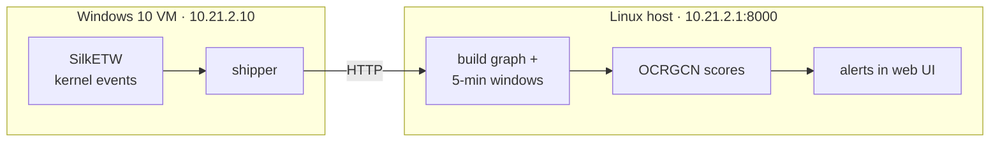

# Phát hiện bất thường trên endpoint device log

**Anomaly detection on endpoint device logs**: NT2102 course project, based on
[OCR-APT](https://doi.org/10.1145/3719027.3765219) (Aly, Mansour, Youssef, ACM CCS 2025).

We record kernel activity on a Windows 10 VM with ETW, turn it into a provenance graph (process, file
and network nodes), compute behaviour features per node, and train one one-class graph neural network
(OCRGCN) per node type on benign activity only. A live demo scores every 5-minute window and shows
alerts in a web UI.

**End goal:** a real attack run during the live demo raises a true alert while benign windows stay
green. Scope is the paper's core detector with simplified alert subgraphs. The paper's LLM report
stage and a formal evaluation are out of scope. Current status: `docs/PROGRESS.md`.


## How the demo works



## Quick start (no VM needed)

```bash
git submodule update --init OCR-APT        # upstream paper repo (paper PDF inside)
uv sync                                    # Python 3.12 + dependencies from uv.lock
uv run python src/pipeline/train_gnn_models.py --selftest
uv run python src/pipeline/score_window.py --selftest
uv run python src/live/engine.py --selftest
uv run python src/live/etwship.py --selftest
```

Then follow **[src/README.md → Start here](src/README.md#start-here-new-member)**.

## Repository layout

| path | what it is |
|---|---|
| `src/` | lab VM (Vagrant + PowerShell), host pipeline, live demo, trained artifacts, notebooks. Map in `src/README.md` |
| `docs/` | `PROGRESS.md` (status), `DEVIATIONS.md` (differences from the paper), `reports/` (professor brief, teammate guide), `explainers/` (edges → node features page) |
| `OCR-APT/` | git submodule: the authors' code ([CoDS-GCS/OCR-APT](https://github.com/CoDS-GCS/OCR-APT)) and the paper PDF |
| `ocrapt-live-windows.html` | design mock of the live demo UI |
| `pyproject.toml`, `uv.lock` | Python dependencies, managed with [uv](https://docs.astral.sh/uv/) |
| `CLAUDE.md` | project context for Claude Code sessions |
| `dataset/`, `original-dataset/`, `dataset.tar.xz` | NODLINK simulated data and the OCR-APT dataset archive (large, not in git) |

## Documentation

| read this | for |
|---|---|
| `docs/reports/professor.md` | the 5-minute project overview |
| `src/README.md` | what each folder is, and where a new member starts |
| `docs/reports/teammate.md` | how to run each part, pitfalls, open tasks |
| `src/live/README.md` | live demo runbook (replay without a VM, or live with the VM) |
| `docs/PROGRESS.md` / `docs/DEVIATIONS.md` | current status / what we changed from the paper and why |

## Requirements

- Linux host with [uv](https://docs.astral.sh/uv/) (Python ≥ 3.12).
- For the lab VM: VirtualBox + Vagrant, about 8 GB free RAM for the VM. Run `src/setup-virtualbox.sh`
  once to allow the 10.21.2.0/24 host-only network, then `cd src && vagrant up`.
- Docker only for GraphDB (`src/graphdb/compose.yaml`), which the live demo does not need.

## Safety

Attack scenarios (`src/atomic-attack-pack/`) run only inside the lab VM, with the VM cut off from the
internet (`LAB_ISOLATED=1 vagrant reload`). Never run them on another machine.

## References

- A. Aly, E. Mansour, A. Youssef. *OCR-APT: Reconstructing APT Stories from Audit Logs using Subgraph
  Anomaly Detection and LLMs.* ACM CCS 2025. doi:10.1145/3719027.3765219. Code:
  [CoDS-GCS/OCR-APT](https://github.com/CoDS-GCS/OCR-APT).
- S. Li et al. *NODLINK: An Online System for Fine-Grained APT Attack Detection and Investigation.*
  NDSS 2024. Data: [PKU-ASAL/Simulated-Data](https://github.com/PKU-ASAL/Simulated-Data).

## License

MIT, see `LICENSE`.
