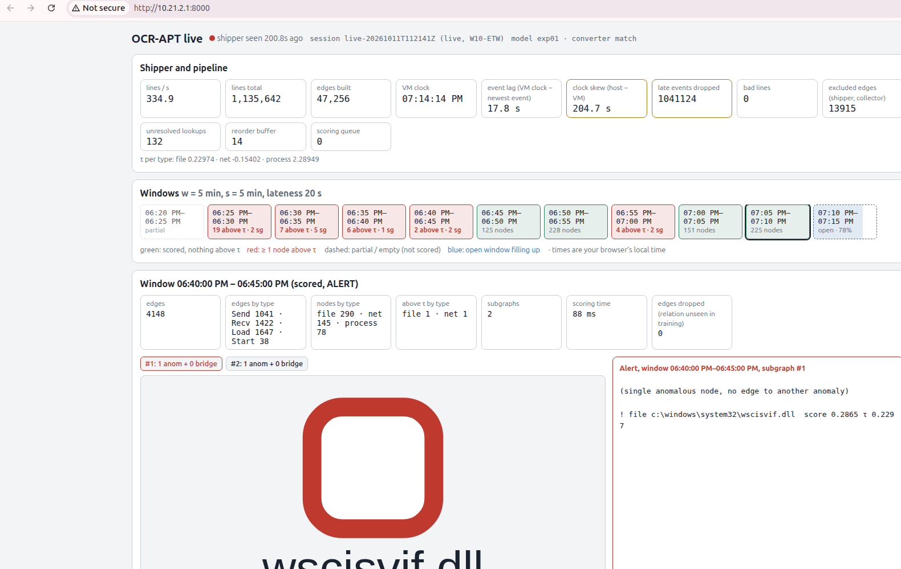
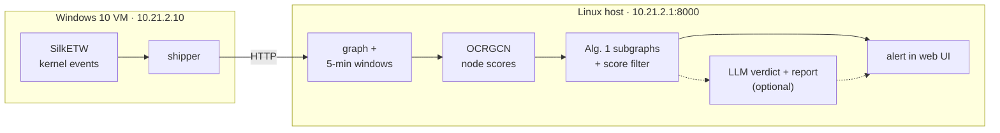

# Phát hiện bất thường trên endpoint device log

**Anomaly detection on endpoint device logs**: NT2102 course project.

**Goal:** catch an attack on a Windows host *live*, from kernel audit logs. Target demo: an attacker
exploits a CVE in a lab service, gets remote code execution, then runs follow-on MITRE ATT&CK techniques
(discovery, persistence, credential access, C2, exfiltration). The window where it happens turns red;
benign windows stay green. The detector is not limited to APTs: it flags host behaviour that benign
training never showed.

**Method:** the core idea of [OCR-APT](https://doi.org/10.1145/3719027.3765219) (Aly, Mansour, Youssef,
ACM CCS 2025), built as a live demo. **Not a full reproduction** of the paper. Status: `docs/PROGRESS.md`.



## What we keep, adapt and leave out (details: `docs/DEVIATIONS.md`)

- **Keep:** provenance graph of process / file / network nodes; 15 behaviour features per node
  (paper §5.1.2); one one-class GNN per node type (OCRGCN), trained on benign activity only; Alg. 1
  anomalous subgraphs + subgraph-score filter; the paper's Alg. 2 prompts for attack reports.
- **Adapt:** our own Windows 10 ETW captures instead of NODLINK / DARPA; 5-min windows scored live instead
  of the whole log offline; own trainer; our alert cut-off (Moderate ≥ 30); an LLM triage verdict before the
  paper's report prompts.
- **Leave out:** the paper's evaluation (datasets, metrics, baselines; none of our numbers compare to its
  tables), GraphDB, Alg. 2 l.16–25.
- **Attacks today:** Atomic Red Team + custom ATT&CK scripts (`src/atomic-attack-pack/`). The CVE → RCE
  scenario is planned, not built.

## How the demo works



## Quick start (no VM needed)

```bash
git submodule update --init OCR-APT        # upstream paper repo (paper PDF inside)
uv sync                                    # Python 3.12 + dependencies from uv.lock
./selftest.sh                              # selftests, PASS/FAIL per step ("it runs", not "it detects")
```

| shortcut (`-h` for usage) | does |
|---|---|
| `./serve.sh [live\|local] [flags]` | live server with exp01; `live` binds 10.21.2.1 (VM), `local` 127.0.0.1 (replay) |
| `./replay.sh <session-id\|raw-dir> [speed]` | replays a recorded capture into `./serve.sh local` |
| `./rejudge.sh <session-id> [llm-provider]` | Alg. 1 + filter again on a saved session, then the LLM step |

Defaults can be overridden with `RUN_DIR`, `SCALER`, `EXPERIMENT`, `PORT`. Next: **[src/README.md → Start here](src/README.md#start-here-new-member)**.

## Repository layout

| path | what it is |
|---|---|
| `src/` | lab VM (Vagrant + PowerShell), host pipeline, live demo, trained artifacts, notebooks. Map in `src/README.md` |
| `docs/` | `PROGRESS.md` (status), `DEVIATIONS.md` (differences from the paper), `reports/`, `notes/`, `explainers/` |
| `OCR-APT/` | git submodule: the authors' code ([CoDS-GCS/OCR-APT](https://github.com/CoDS-GCS/OCR-APT)) and the paper PDF |
| `pyproject.toml`, `uv.lock` | Python dependencies, managed with [uv](https://docs.astral.sh/uv/) |
| `CLAUDE.md` | project context for Claude Code sessions |
| `dataset/`, `original-dataset/`, `dataset.tar.xz` | NODLINK simulated data and the OCR-APT dataset archive (large, not in git) |

## Requirements

- Linux host with [uv](https://docs.astral.sh/uv/) (Python ≥ 3.12).
- Lab VM: VirtualBox + Vagrant, about 8 GB free RAM. Build steps in `src/README.md`.
- Docker on the Ubuntu trainer only (Loki + Grafana, installed by Ansible).

## Safety

Attack scenarios (`src/atomic-attack-pack/`) run only inside the lab VM, with the VM cut off from the
internet (`LAB_ISOLATED=1 vagrant reload`). Never run them on another machine.

## References

- A. Aly, E. Mansour, A. Youssef. *OCR-APT: Reconstructing APT Stories from Audit Logs using Subgraph
  Anomaly Detection and LLMs.* ACM CCS 2025. doi:10.1145/3719027.3765219. Code:
  [CoDS-GCS/OCR-APT](https://github.com/CoDS-GCS/OCR-APT).
- S. Li et al. *NODLINK: An Online System for Fine-Grained APT Attack Detection and Investigation.*
  NDSS 2024. Data: [PKU-ASAL/Simulated-Data](https://github.com/PKU-ASAL/Simulated-Data).

## License

MIT, see `LICENSE`.
