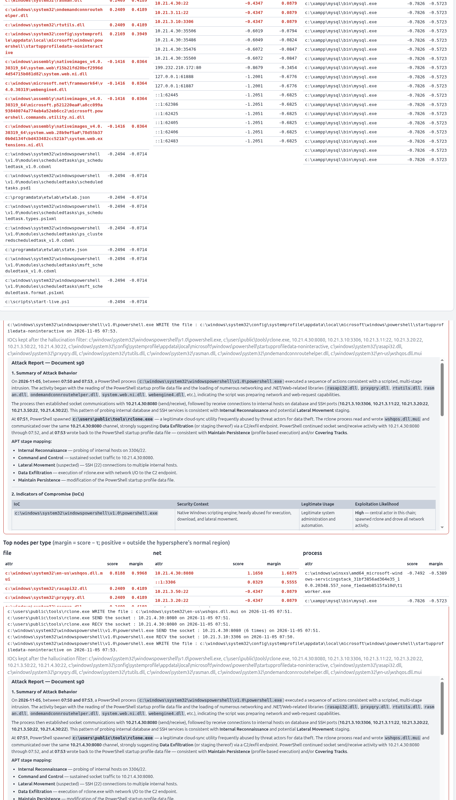

# Live attack detection from endpoint audit logs

A one-class graph neural network that learns a Windows host's normal kernel activity and turns a live attack
red within its 5-minute window, with an LLM-written incident report. Built on the core method of
[OCR-APT](https://doi.org/10.1145/3719027.3765219) (Aly, Mansour, Youssef, ACM CCS 2025). NT2102 course project.

- **[Explore the recorded data](https://projects.datrollout.dev/nt2102/)**: every window, alert subgraph and LLM report from the live run (read-only snapshot)
- **[Video: react2shell attack detected live](https://youtu.be/DzUX-xf_72s)**
- **[Slides](https://uitprojects.github.io/NT2102/)** · Status: proof of concept, lab torn down.

## Outcome

- **DVWA → RCE → ATT&CK chain** (`ws-etw-0`): 3 of 3 live runs went red, each with an LLM `attack` verdict.
  First 24 h live: 279 windows, 7 alerts (4 attack, 3 benign false alarms).
- **Real react2shell attack** (Next.js RCE on `ws-etw-1`, run by a team member): red at subgraph score 7.24 and 19.86,
  LLM `attack` 0.85 / 0.95 ([video](https://youtu.be/DzUX-xf_72s)). In-sample: the alert cut-off was tuned on this run.
- **Public demo**: 4,658 recorded windows (2026-11-02 → 11-15), 63 red, 17 LLM `attack`. Replays the scores
  computed live at the time. Nothing is re-scored.



## Stack

Python ETW collector · Loki / Grafana · PyTorch Geometric (RGCN, Deep SVDD loss) · FastAPI + SSE · LLM triage ·
Terraform on Proxmox · Ansible · Docker · Kubernetes / Argo CD / Traefik · GitHub Actions

## Architecture

```
Windows VM   ETW kernel events (process / file / network) ──push──► Loki
Trainer      Loki ─► provenance graph ─► 15 behaviour features per node ─► one OCRGCN per node type
                (train: idle benign only)                     (live: score each 5-min window)
             anomalous nodes ─► connected subgraphs + subgraph score (Alg. 1) ─► red window
             red window ─► LLM verdict + incident report (Alg. 2) ─► web UI with full history
Demo         recorded snapshot ─► same UI, read-only, in a container on k8s
```

## Attacks

| phase | ATT&CK |
|---|---|
| Web command injection → RCE shell | T1190, T1059.001 |
| Discovery | T1033, T1082, T1057, T1016 |
| Internal scan | T1046 |
| Real tool download + run (PsExec, rclone, nmap, ncat) | T1105, T1569.002 |
| DB enumeration + dump | T1552, T1213 |
| C2 beacon · scheduled task | T1071 · T1053.005 |
| Clear event logs, delete tools | T1070.001, T1070.004 |

Second attack: react2shell Next.js RCE → `node` → PowerShell, winPEAS, service/task enumeration.

## Limits

- Benign baseline = mostly idle activity, so real admin work can raise false alarms.
- The subgraph score sums over flagged nodes: large benign clusters can cross the threshold too.
- Thresholds were tuned on the attacks shown (in-sample). No labelled ground truth, no formal evaluation.
- The LLM is a second opinion and can over-read (for example, calling a download "exfiltration").
- Small evidence: a few runs of two attacks on two hosts.

## Repository

| path | what |
|---|---|
| `src/etw-python/` | ETW collector (stdlib + ctypes) |
| `src/pipeline/` | graph, features, OCRGCN training, scoring, Alg. 1, Alg. 2 |
| `src/live/` | live engine, FastAPI server, web UI, snapshot playback |
| `src/atomic-attack-pack/` | the RCE kill chain and its launcher |
| `src/ansible/` · `infrastructure/` | lab provisioning · Proxmox VMs and network (Terraform) |
| `deploy/` | demo image, k8s manifests, Argo CD app |
| `docs/` | design notes, deviations from the paper, explainers |
| `latex/` · `presentation/` | report · slides |

## References

- A. Aly, E. Mansour, A. Youssef. *OCR-APT: Reconstructing APT Stories from Audit Logs using Subgraph
  Anomaly Detection and LLMs.* ACM CCS 2025. doi:10.1145/3719027.3765219. Code:
  [CoDS-GCS/OCR-APT](https://github.com/CoDS-GCS/OCR-APT).
- S. Li et al. *NODLINK: An Online System for Fine-Grained APT Attack Detection and Investigation.*
  NDSS 2024. Data: [PKU-ASAL/Simulated-Data](https://github.com/PKU-ASAL/Simulated-Data).

## License

MIT, see `LICENSE`.
