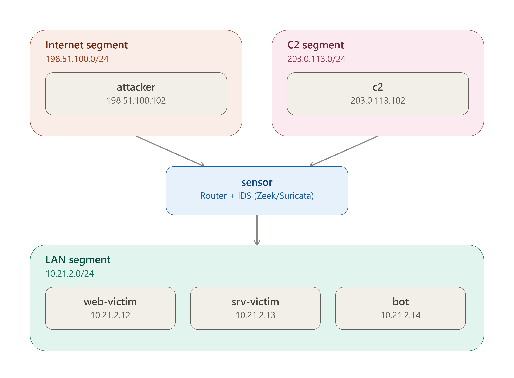

# NT2102 Network Anomaly

Provider-neutral network-anomaly lab for generating and analysing traffic across a controlled, isolated topology.

## Team

- datnvm
- kiettq
- longnl

## Lab network

The diagram and addressing below are the shared lab contract. Every team member may use their preferred virtualization solution—such as VirtualBox, VMware, KVM/libvirt, Proxmox, or a cloud-equivalent environment—but must preserve this topology.

### Required network segments

| Segment | CIDR | Purpose |
|---|---|---|
| `nt2102-lan` | `10.21.2.0/24` | Internal corporate network for the victim systems and bot. |
| `nt2102-internet` | `198.51.100.0/24` | Simulated external-attacker network. |
| `nt2102-c2` | `203.0.113.0/24` | Simulated command-and-control network. |

### Required virtual machines

| VM | Role | Required address(es) | Required network membership |
|---|---|---|---|
| `attacker` | External threat actor | `198.51.100.102` | `nt2102-internet` |
| `web-victim` | Vulnerable web application target | `10.21.2.12` | `nt2102-lan` |
| `srv-victim` | SSH/FTP/MySQL service target | `10.21.2.13` | `nt2102-lan` |
| `bot` | Compromised host that generates C2 beacon traffic | `10.21.2.14` | `nt2102-lan` |
| `c2` | Simulated command-and-control endpoint | `203.0.113.102` | `nt2102-c2` |
| `sensor` | Traffic sensor and multi-network host | `10.21.2.11`, `198.51.100.11`, `203.0.113.11` | `nt2102-lan`, `nt2102-internet`, `nt2102-c2` |

`sensor` is the only VM attached to all three network segments. All other VMs must attach only to the segment listed above.

## Implementation freedom

The hypervisor, guest operating-system images, provisioning method, routing configuration, and firewall policy are implementation choices. They may vary between team members, provided that they do not change the VM names, roles, IP addresses, subnet assignments, or required interface placement defined in this README.

For the full provider-neutral component reference, see [Lab VM reference](lab-network-topology/lab-vm.md).

## Vagrant implementation

[datnvm's Vagrant and VirtualBox guide](datnvm/README.md) is one implementation of this topology. It is optional and is not a project-wide virtualization requirement.

## Safety

Use attack tooling only against the isolated lab targets. Do not point lab attack scripts or scans at external systems.
