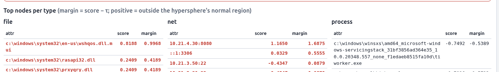
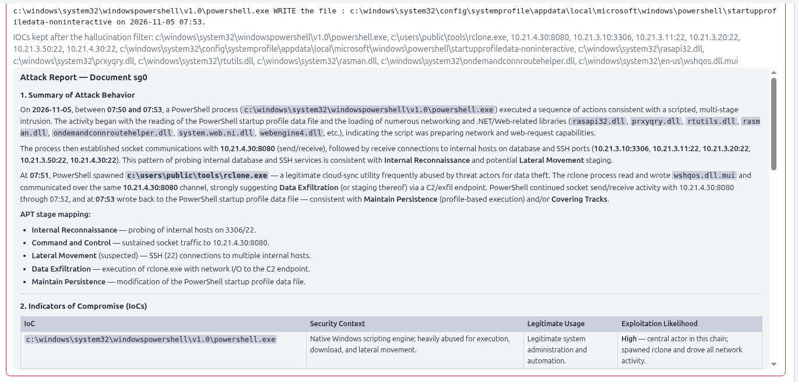

# Live attack detection from endpoint audit logs

A self-hosted, end-to-end system that watches a Windows host's kernel activity in real time and raises
a true alert within 5 minutes of a live attack — from exploit to post-exploitation — while staying quiet
on normal usage. Built as a security/ML systems project (NT2102 coursework), on the core detection
method from [OCR-APT](https://doi.org/10.1145/3719027.3765219) (Aly, Mansour, Youssef, ACM CCS 2025).

**Status: proof of concept, not production-ready.** It proves the detection method works live, end to
end, on one host and one demo attack — it is not a hardened, multi-host security product. See §5.

## What this demonstrates
- **Offensive security engineering:** a realistic, ATT&CK-mapped attack chain — exploit → discovery →
  lateral tooling → C2 → persistence — using real, signed tools (not malware), delivered from a
  dedicated attacker VM against an isolated target.
- **Applied ML on security telemetry:** a provenance-graph pipeline (process/file/network nodes) feeding
  a one-class graph neural network trained only on benign behaviour, scoring live traffic with no labeled
  attack data required.
- **LLM-assisted triage:** a second-opinion LLM step that turns a statistical anomaly into a
  human-readable verdict and incident report — the kind of alert-fatigue reduction SOC tooling needs.

## 1. Goal

Most anomaly detectors need labeled attack data, which is scarce and expensive. This project asks: can a
model trained **only on a machine's normal behaviour** catch an attack it has never seen, live, with
enough context for a human to act on it? The target outcome: a web dashboard where a 5-minute window of
activity goes from green to red *during* a live attack, backed by an LLM-written explanation of what
happened and why it's suspicious — not just a score.

## 2. Demo scenario

**Setup:** a vulnerable internal web app (command-injection bug) exposed on the monitored host; a
separate attacker VM on an isolated network.

**Attack:** the attacker exploits the app to get a shell, then runs a realistic post-exploitation chain —
system/network discovery, an internal port scan, downloading and *executing* real admin/pentest tools
(PsExec, rclone) as a real attacker would, read-only database enumeration, a C2 beacon, and a persistence
mechanism.

**Outcome:** every normal (idle) 5-minute window stays green. The attack window is flagged red by the
model, and the LLM layer independently confirms it as an attack with a written
incident report — IOCs, affected hosts, and the ATT&CK stages — generated live, with no human writing a
single detection rule. Both are generated live, from the same red window:

**The model's own output** — the specific nodes (files, network endpoints, processes) that the GNN
flagged as outside normal behaviour, and by how much:

**The LLM's explanation**, built from that same output — a written incident narrative and IOC table,
with no human writing a single detection rule:

Full attack phase breakdown (ATT&CK techniques)

| phase | technique(s) | what happens |
|---|---|---|
| Initial access / execution | T1190, T1059.001 | Web app command injection → RCE shell |
| Discovery | T1033, T1082, T1057, T1016 | user/system/process/network enumeration |
| Network service scan | T1046 | internal subnet sweep |
| Tool transfer + execution | T1105, T1569.002 | downloads and runs real signed tools (PsExec as SYSTEM, rclone) |
| Credential access / DB | T1552, T1213 | read-only DB enumeration + dump |
| C2 | T1071 | periodic beacon to the attacker |
| Persistence | T1053.005 | scheduled task |

## 3. Infrastructure

Everything runs in an isolated, automated lab built from scratch — no manual VM clicking after the first
boot:

- **Provisioning:** Terraform defines the network and VMs on a home Proxmox hypervisor; Ansible
  configures every box (collector agents, the database/web app under test, the training/serving stack,
  the attacker toolkit) idempotently — re-running a playbook changes nothing on an already-configured box.
- **Network isolation:** the monitored host, the training/inference server, a second (Linux) endpoint,
  and the attacker each sit on their own firewalled virtual network. Attack traffic never leaves the lab.
- **Observability backbone:** a log-aggregation service (Loki/Grafana) decouples data collection from
  training and inference — the same event stream feeds both the training pipeline and the live detector.
- **Remote access:** a VPN endpoint for off-site administration of the lab.

## 4. Pipeline

**Training** turns raw kernel event logs into a detector with no attack data in the loop: build a
provenance graph from a window of normal activity → extract a fixed feature vector per node → train a
graph neural network per node type to recognize "normal" as a tight region in embedding space (one-class
learning) → gate the result against sanity checks before it's ever served live. One command runs the
whole loop end to end.

**Inference** runs the same pipeline live: stream kernel events in real time → score every node against
the trained model as each 5-minute window closes → group anomalous nodes into connected subgraphs and
score each one → alert when a subgraph crosses a calibrated threshold → on alert, hand the subgraph to an
LLM for a second-opinion verdict and a written report → surface everything on a live web dashboard with
full history.

## 5. Known constraints

Shipping this honestly means stating what it is not:

- **Trained on a thin "normal" baseline** (idle machine time). It makes the demo attack easy to separate
  from normal, but real, varied day-to-day usage (remote sessions, admin work) can also look unfamiliar
  and trigger a false alarm.
- **Not production-hardened:** single-host demo scale, no high availability, no secrets management beyond
  a local vault file, no multi-tenant support — built to prove the detection method, not to run a fleet.

## References

- A. Aly, E. Mansour, A. Youssef. *OCR-APT: Reconstructing APT Stories from Audit Logs using Subgraph
  Anomaly Detection and LLMs.* ACM CCS 2025. doi:10.1145/3719027.3765219. Code:
  [CoDS-GCS/OCR-APT](https://github.com/CoDS-GCS/OCR-APT).
- S. Li et al. *NODLINK: An Online System for Fine-Grained APT Attack Detection and Investigation.*
  NDSS 2024. Data: [PKU-ASAL/Simulated-Data](https://github.com/PKU-ASAL/Simulated-Data).

## License

MIT, see `LICENSE`.
