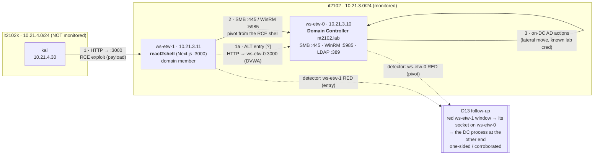

# Cross-host attack flow — network view (proposal, 2026-11-13)

**Status: HYPOTHESIS / my imagination.** This is the attack path I want us to run end-to-end so the detector's
cross-host correlation (D13) fires on a *real* flow, not a synthetic one. It is network-focused on purpose.
Nothing here is a detection claim. Open questions for you are marked **[?]** — fill them with what
`react2shell` actually allows.

## Lab network (who is where)

| Host | IP | VNet | Role | Listens on (relevant) | Monitored? |
|---|---|---|---|---|---|
| `kali` | 10.21.4.30 | `it2102k` 10.21.4.0/24 | Attacker | — (serves stage on :8080) | **No** |
| `ws-etw-1` | 10.21.3.11 | `it2102` 10.21.3.0/24 | `react2shell` (Next.js RCE), domain member | **:3000** HTTP (react2shell) | **Yes** (collector + Sysmon) |
| `ws-etw-0` | 10.21.3.10 | `it2102` 10.21.3.0/24 | **Domain Controller** `nt2102.lab` | **:445** SMB, **:5985** WinRM, :389/:636 LDAP, :88 Kerberos, :53 DNS, :3000 DVWA | **Yes** (collector + Sysmon) |

The two VNets are routed (pve-master). Only the two Windows hosts run our collector, so **Kali's own actions
are invisible** — the first thing we can see is the exploit *landing* on `ws-etw-1`.

## The flow

### Hop by hop (src → dst : port / protocol → purpose)

1. **`kali:* → ws-etw-1:3000`** (HTTP) — **RCE entry** into `react2shell`. Kali sends the exploit; the payload
   runs on `ws-etw-1` as a child of the node server (`node.exe → cmd/powershell → …`). This is the first
   monitored event. **[?]** exact route/param on :3000 that gives code exec (injection? unauth endpoint?
   deserialization?) — you know react2shell, I don't.
   - *Alternative entry I floated:* **`kali → ws-etw-0:3000`** (DVWA command injection). Keep this only as a
     fallback — it enters *on the DC directly* and skips the pivot, so it does **not** exercise cross-host
     correlation. The point of this exercise is the pivot, so prefer entry on `ws-etw-1`.
2. **`ws-etw-1 → ws-etw-0` pivot** from the RCE shell to the DC, over the network. **Preferred: WinRM `:5985`
   (`winrs -r:10.21.3.10 …` / PS remoting); SMB `:445` also works now, with a caveat below.**
   On-host Windows built-ins are enough. **[?]** which technique + which credential — a known lab admin cred is
   fine (this demonstrates *lateral movement detection*, not credential theft).

   **How the correlation layer sees the pivot (anomaly-first since 2026-11-15, D13):** it does nothing until a
   `ws-etw-1` window goes **red**. Then it takes every socket node inside that window's *kept* anomalous subgraph
   that points at `10.21.3.10`, finds the exact connection in the raw network events, and looks at the process on
   the DC that owns the other end, scored by the DC's own model. So the pivot is followed only if **the shell
   process that opens the connection sits in the red subgraph on `ws-etw-1`**. There is no known-traffic list any
   more, so SMB `:445` is no longer invisible.

   **Why WinRM is still the better choice [INFERENCE]:** a member ↔ DC runs SMB/LDAP/Kerberos/DNS all the time
   (24 h on 2026-11-13: `ws-etw-1→ws-etw-0` tcp/445, 389, 88, 135, udp/389, 53; `ws-etw-0→ws-etw-1` udp/123,
   tcp/dyn). On the DC, the process that answers SMB is `System`, which also answers the benign traffic, so the
   DC's model will probably score it as normal (`one-sided`). A WinRM pivot lands in `wsmprovhost.exe` (PS remoting) or `winrshost.exe` (`winrs`) on the DC,
   which an idle DC rarely runs, so it has a better chance of being flagged (`corroborated`).
3. **on `ws-etw-0` (DC)** — the action after landing: enumerate AD / read a share / run a command as the pivoted
   identity. **[?]** what exactly. **Out of scope:** DCSync, real credential dumping (`lsass`), anything we
   can't label honestly.

## Where the detector should react (what we're verifying)

- `ws-etw-1` window goes **RED** on the react2shell exploit; its process rows show the **real command lines**
  (Sysmon EID 1, D14) — e.g. the spawned `cmd`/`powershell` under `node.exe`.
- That red window's kept subgraph holds a socket `10.21.3.10:5985` (or `:445`), so a **cross-host finding** opens
  for `ws-etw-1 → ws-etw-0`.
- On the DC, the process at the other end (`wsmprovhost.exe` / `winrshost.exe` for WinRM) and what it did are pulled in with the
  DC model's scores: `corroborated` if that model flags any of them, else `one-sided`. `ws-etw-0` may also go red
  on its own; that red window then joins the same finding.
- The LLM gets both sides in one document, explains the whole path and cites the command lines.
- Idle windows around the attack stay **green** on both hosts.

**Honest risks (not hidden):** (a) the react2shell exploit may *not* go red — the node server is in the benign
baseline, so a single child process might stay under the subgraph cut-off. (b) The DC pivot auth can blend into
normal AD traffic (the finding then stays `one-sided`). (c) If the shell process that opens the pivot is not
inside the red subgraph on `ws-etw-1`, the pivot is not followed at all. If either stays green, that's a **finding we report**, and tells us what to strengthen.

## What I need from you (the "things I can't think of")

- **[?]** The real react2shell entry on `ws-etw-1:3000` — the route/param and payload shape.
- **[?]** The pivot you'll use `ws-etw-1 → ws-etw-0` — **please pick WinRM :5985 if you can** (reason above);
  tell me if you must use SMB :445 so I set expectations on the correlation layer.
- **[?]** The DC action to perform (kept to lateral movement; no DCSync).
- **[?]** Any port/protocol that differs from the ones above, so I know which DC process to expect at the other end.

Once we agree, you run it; I record the start/end time and your account (that's our only ground truth — there's
no injected label oracle for a real attack), and I check each host + the correlation.
