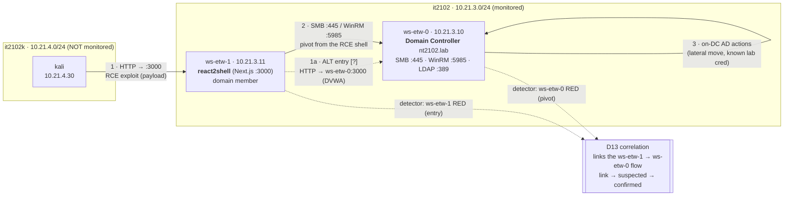

# Cross-host attack flow — network view (proposal, 2026-11-13)

**Status: HYPOTHESIS / my imagination.** This is the attack path I want us to run end-to-end so the detector's
cross-host correlation (D13) fires on a *real* flow, not a synthetic one. It is network-focused on purpose.
Nothing here is a detection claim. Open questions for you are marked **[?]** — fill them with what
`react2shell` actually allows.

## Lab network (who is where)

| Host | IP | VNet | Role | Listens on (relevant) | Monitored? |
|---|---|---|---|---|---|
| `kali` | 10.21.4.30 | `it2102k` 10.21.4.0/24 | Attacker | — (serves stage on :8080) | **No** |
| `ws-etw-1` | 10.21.3.11 | `it2102` 10.21.3.0/24 | `react2shell` (Next.js RCE), domain member | **:3000** HTTP (react2shell) | **Yes** (collector + Sysmon) |
| `ws-etw-0` | 10.21.3.10 | `it2102` 10.21.3.0/24 | **Domain Controller** `nt2102.lab` | **:445** SMB, **:5985** WinRM, :389/:636 LDAP, :88 Kerberos, :53 DNS, :3000 DVWA | **Yes** (collector + Sysmon) |

The two VNets are routed (pve-master). Only the two Windows hosts run our collector, so **Kali's own actions
are invisible** — the first thing we can see is the exploit *landing* on `ws-etw-1`.

## The flow

### Hop by hop (src → dst : port / protocol → purpose)

1. **`kali:* → ws-etw-1:3000`** (HTTP) — **RCE entry** into `react2shell`. Kali sends the exploit; the payload
   runs on `ws-etw-1` as a child of the node server (`node.exe → cmd/powershell → …`). This is the first
   monitored event. **[?]** exact route/param on :3000 that gives code exec (injection? unauth endpoint?
   deserialization?) — you know react2shell, I don't.
   - *Alternative entry I floated:* **`kali → ws-etw-0:3000`** (DVWA command injection). Keep this only as a
     fallback — it enters *on the DC directly* and skips the pivot, so it does **not** exercise cross-host
     correlation. The point of this exercise is the pivot, so prefer entry on `ws-etw-1`.
2. **`ws-etw-1 → ws-etw-0` pivot** from the RCE shell to the DC, over the network. **Pick the port with care
   (data-backed, see below): use WinRM `:5985` (`winrs -r:10.21.3.10 …` / PS remoting), NOT SMB `:445`.**
   On-host Windows built-ins are enough. **[?]** which technique + which credential — a known lab admin cred is
   fine (this demonstrates *lateral movement detection*, not credential theft).

   **Why not SMB :445:** a member ↔ DC runs SMB/LDAP/Kerberos/DNS *constantly*, so those flows are in our
   `lab flows` baseline, and the correlation layer **skips any flow already in the baseline**
   (`correlate.py:221`). A pivot reusing one of them is invisible to the *flow* layer (both hosts can still go
   red on their own). Baseline recorded 2026-11-13 (24 h, `src/artifacts/flow-baseline.json`):

   | In the baseline (pivot here = NOT flagged) | Not in the baseline (pivot here = flagged as a new link) |
   |---|---|
   | `ws-etw-1→ws-etw-0` tcp/445 SMB, tcp/389 LDAP, udp/389 CLDAP, tcp/88 Kerberos, tcp/135 RPC, udp/53 DNS; `ws-etw-0→ws-etw-1` udp/123 NTP, tcp/dyn | **tcp/5985 WinRM**, tcp/3389 RDP, tcp/22 SSH, any other port |

   So: **WinRM :5985 is the clean choice** — it's a normal admin pivot and it's not in the baseline, so
   `link → suspected → confirmed` can fire. (This is the D6 "DC auth blends into AD traffic" risk, confirmed at
   the flow level. If you must pivot over SMB, say so — we'd verify via each host going red, not via the link.)
3. **on `ws-etw-0` (DC)** — the action after landing: enumerate AD / read a share / run a command as the pivoted
   identity. **[?]** what exactly. **Out of scope:** DCSync, real credential dumping (`lsass`), anything we
   can't label honestly.

## Where the detector should react (what we're verifying)

- `ws-etw-1` window goes **RED** on the react2shell exploit; its process rows show the **real command lines**
  (Sysmon EID 1, D14) — e.g. the spawned `cmd`/`powershell` under `node.exe`.
- A **`ws-etw-1 → ws-etw-0` flow** on :445/:5985 appears that is **not** in the `lab flows` baseline.
- `ws-etw-0` window goes **RED** on the pivot activity.
- **Correlation** ties them: `link → suspected → confirmed`, and the LLM campaign document explains the whole
  path and cites the command lines.
- Idle windows around the attack stay **green** on both hosts.

**Honest risks (not hidden):** (a) the react2shell exploit may *not* go red — the node server is in the benign
baseline, so a single child process might stay under the subgraph cut-off. (b) The DC pivot auth can blend into
normal AD traffic. If either stays green, that's a **finding we report**, and tells us what to strengthen.

## What I need from you (the "things I can't think of")

- **[?]** The real react2shell entry on `ws-etw-1:3000` — the route/param and payload shape.
- **[?]** The pivot you'll use `ws-etw-1 → ws-etw-0` — **please pick WinRM :5985 if you can** (reason above);
  tell me if you must use SMB :445 so I set expectations on the correlation layer.
- **[?]** The DC action to perform (kept to lateral movement; no DCSync).
- **[?]** Any port/protocol that differs from the table above, so I can set the `lab flows` baseline correctly.

Once we agree, you run it; I record the start/end time and your account (that's our only ground truth — there's
no injected label oracle for a real attack), and I check each host + the correlation.
