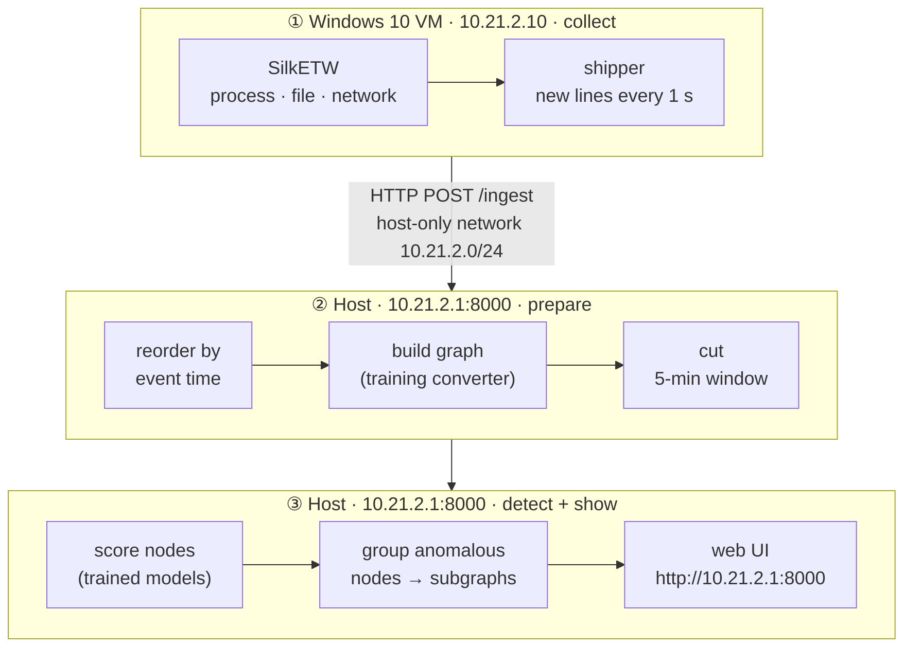
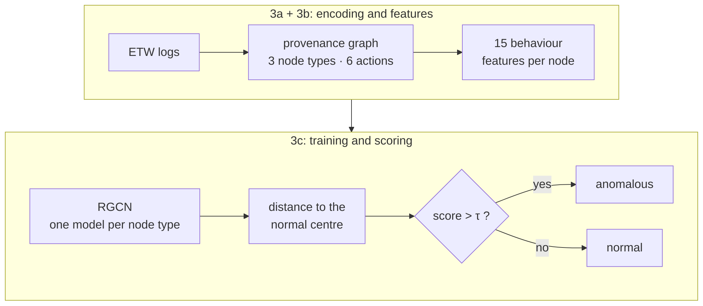

# Phát hiện bất thường trên endpoint device log

**Anomaly detection on endpoint device logs, based on OCR-APT (CCS 2025)** · NT2102 · status 2026-10-11

> **Built:** a live demo that turns Windows 10 kernel logs into a graph and scores every 5-minute window with one-class graph neural networks.
>
> **Works:** end to end, live. The first window flagged 19 of 835 nodes, all from one benign updater the model had never seen.
>
> **Next:** cut benign false alarms (the paper's subgraph-score filter, more benign training data), then show a real attack raising a true alert live.

## 1. Introduction

- **Problem:** spot attacker activity on a Windows endpoint from its audit logs, **without attack labels** for training.
- **Idea, from OCR-APT [P1]:**
  1. turn the logs into a provenance graph (who did what to what);
  2. learn what "normal" looks like for each node type;
  3. flag nodes that don't fit.
- **Our data:** our own Windows 10 VM; kernel events from ETW via SilkETW; a scripted benign workload.
- **Scope:** about 40 % of the paper: the detector plus simplified alert subgraphs. The LLM report stage is not built.
- **Goal:** demonstrate the paper's core concept live. A real attack run during the demo should raise a true alert while benign windows stay green. Publishing-style evaluation and metrics are out of scope.
- **Where we are:** it runs end to end, live, on benign activity. No attack has been demoed yet.

## 2. Demo architecture



- The VM (10.21.2.10) only collects and ships logs to the host (10.21.2.1, port 8000) over a private host-only network. All processing runs on the host.
- The host uses **the same conversion code and settings as training**, so live scores match offline scores.
- Each closed 5-minute window is scored; anomalous nodes are linked into alert subgraphs.
- **UI:** a timeline of windows (green = normal, red = alert), the alert graph, and the top nodes per type.

## 3. Core of the paper we are coding



**3a. Encoding: logs → graph**
- Nodes: **process, file, network**. Edges: **start, load, read, write, send, receive**. This is the NODLINK schema the paper's code expects [P2, D1].
- Stable IDs: a process is PID + start time, because PIDs get reused. A file or socket is a hash of its path or address, so the same file has the same ID in training and in live data.

**3b. Features (paper §5.1.2)**: 15 numbers per node
- 12 = how often the node does each action, outgoing and incoming, scaled so the 12 values have length 1.
- 3 = shortest, longest and average idle time between its actions, scaled to 0–1.
- Example: a DLL loaded once has `in_load = 1` and every other value 0.

**3c. Training (paper §5.1)**
- One model per node type, trained on **benign data only**.
- A 3-layer relational GCN (RGCN) [P3] turns each node and its neighbours into 32 numbers (an embedding).
- Training pulls normal embeddings into a sphere with centre c and radius r.
- Anomaly score = squared distance to c minus r². The alarm line τ is set so only 0.1 % of training nodes cross it.

| what we have | value |
|---|---|
| benign training capture | 20 min, cut into 8 windows |
| graph size | 68,319 edges · 6,810 nodes (995 process · 2,558 file · 3,257 network) |
| alarm line τ (seed 360) | process 2.29 · file 0.23 · network −0.15 |
| first live window | 835 nodes, 19 flagged (all files, one benign updater) |

**Differences from the paper:** our own data instead of its datasets, our own trainer code, and 5-minute windows instead of the whole log at once. Each is listed in `docs/DEVIATIONS.md`.

## 4. Progress

Each bar counts concrete milestones (✓ done, ○ open). No percentages are estimated.

```progress
Data lab (VM, ETW collector, converter) | VM build ✓; ETW collector ✓; converter to NODLINK schema ✓; benign capture ✓; attack scenarios ready to run ○
Encoding + features | graph schema ✓; stable node IDs ✓; 15 behaviour features ✓; train-only scaler ✓
Training (OCRGCN) | trainer code ✓; valid run ✓; stable across seeds ○; τ calibrated on benign data ○
Live demo | shipper ✓; windowing + scoring engine ✓; web UI ✓; first scored window ✓; replay check ○
Alert subgraphs (Alg. 1) | simplified subgraphs ✓; subgraph-score filter ○; full GraphDB version ○
Attack demo (end goal) | benign windows stay green ○; run a real attack during the live demo ○; its window raises a true alert ○; the alert subgraph shows the attack's processes and files ○
LLM report stage (Alg. 2) | out of scope
```

**End goal:** a real attack, run live, raises a true alert in the demo. So far only benign activity has been run. The first live window flagged 19 / 835 nodes (2.3 %, target ≈ 0.1 %), all from one benign updater, so benign false alarms have to come down first.

## 5. Next steps

1. **Subgraph-score filter** (paper Alg. 1): alert on a group of anomalous nodes only if their total score is high enough. This would have suppressed the updater alert.
2. **More benign training data**, and set τ on benign data the model didn't train on.
3. **Replay check:** prove the live path gives exactly the same results as the offline pipeline.
4. **Attack demo:** run an Atomic Red Team scenario during the live demo and show its window raising a true alert, with the attack's processes and files in the alert subgraph.

**Risks:** results change a lot between random seeds; the benign data is narrow and scripted, so new benign activity can still raise alerts.

## 6. References

**Related papers**

- **[P1]** A. Aly, E. Mansour, A. Youssef. *OCR-APT: Reconstructing APT Stories from Audit Logs using Subgraph Anomaly Detection and LLMs.* ACM CCS 2025. doi:10.1145/3719027.3765219, arXiv:2510.15188.
- **[P2]** S. Li, F. Dong, X. Xiao, H. Wang, F. Shao, J. Chen, Y. Guo, X. Chen, D. Li. *NODLINK: An Online System for Fine-Grained APT Attack Detection and Investigation.* NDSS 2024.
- **[P3]** M. Schlichtkrull, T. N. Kipf, P. Bloem, R. van den Berg, I. Titov, M. Welling. *Modeling Relational Data with Graph Convolutional Networks.* ESWC 2018.

**Datasets**

- **[D1]** NODLINK Simulated Windows 10 host [P2], from the OCR-APT dataset record, Zenodo doi:10.5281/zenodo.17254415. Used as the log schema reference.

**Tools:** SilkETW (Mandiant) · Atomic Red Team (Red Canary) · PyTorch Geometric · GraphDB 10.8.
