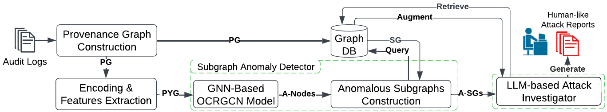
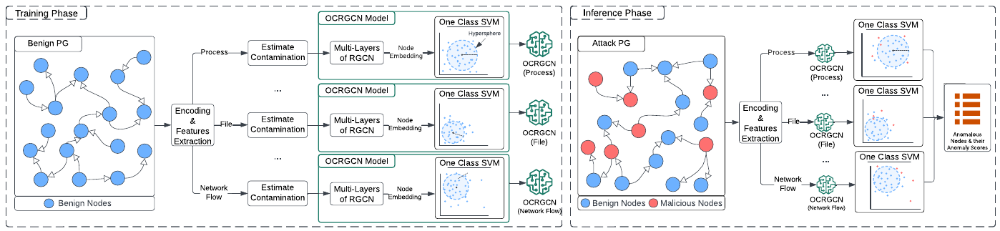

  
  

    ĐẠI HỌC QUỐC GIA TP.HCM TRƯỜNG ĐẠI HỌC CÔNG NGHỆ THÔNG TIN
  

<h1 v-motion :initial="{ x: -60, opacity: 0 }" :enter="{ x: 0, opacity: 1, transition: { duration: 700 } }" style="font-size:2.05rem;line-height:1.2;color:#1e3a8a" class="mb-8">Phát hiện bất thường trên endpoint device log dựa trên OCR-APT</h1>

**Môn học:** An toàn bảo mật hệ thống thông tin 
**GV:** Nguyễn Tấn Cầm 
Học kì 2026–2027

**Thành viên** 
Ngô Vũ Minh Đạt – 26848033@grad.uit.edu.vn 
Nguyễn Long Vũ – 250202060@grad.uit.edu.vn 
Trần Quang Kiệt – 26848108@grad.uit.edu.vn

<!--
Chào thầy/cô và các bạn. Nhóm trình bày một demo trực tiếp của OCR-APT (CCS 2025): phát hiện tấn công
trên log nhân (kernel log) của Windows bằng subgraph anomaly detection. Trọng tâm là cách dữ liệu được
xử lý và một demo thật chạy trên một máy Windows.
-->

---

# Nội dung

  

    1Giới thiệu đề tài
  

  

    2Ý tưởng cốt lõi
  

  

    3Demo
  

  

    4Giới hạn & thách thức
  

  

    5Cảm ơn · Hỏi & Đáp
  

<!--
Năm phần. Phần 2 chiếm phần lớn thời gian: giải thích trực giác trước, rồi mới tới mô hình. Phần 3 là
demo thật, chạy trên một máy Windows. Phần 4 nói thẳng về giới hạn.
-->

---

# 1 · Bài toán: tìm tấn công ẩn trong audit log

### Vì sao khó
- Audit log ghi **mọi** process, file, connection → khổng lồ
- Tấn công **cực hiếm** và **không có nhãn** để học
- Kẻ tấn công dễ đổi tên file / IP để né

### Hệ thống cũ thiếu gì
- Luật / chữ ký → bỏ sót kỹ thuật mới
- Cảnh báo **node-level quá vụn / graph-level quá thô**
- Chỉ cho cảnh báo rời, **không dựng được câu chuyện**

**OCR-APT:** gom thành **subgraph** (cân bằng vụn ↔ thô) · học **hành vi** (không dùng tên/IP) · **LLM** dựng lại cả câu chuyện tấn công.

<!--
Thông điệp (theo Abstract của bài báo): tấn công ẩn trong audit log khổng lồ, cực hiếm, không nhãn. Cách
cũ hoặc bỏ sót (luật), hoặc quá vụn/quá thô (anomaly), hoặc tựa vào tên file/IP dễ giả mạo, và chỉ cho
cảnh báo rời chứ không dựng được câu chuyện. OCR-APT trả lời cả bốn: subgraph + học hành vi + LLM.
Chi tiết từng hạn chế: note.txt Q8.
-->

---

# 1.1 · Mục tiêu đồ án & OCR-APT trong 5 bước

**Mục tiêu:** demo trực tiếp ý tưởng cốt lõi của OCR-APT (Aly et al., ACM CCS 2025) trên **một Windows host**. Khi tấn công thật chạy, window (khung 5 phút) chứa tấn công **chuyển đỏ**, benign (lành tính) window **giữ xanh**. Proof of concept phần lõi — **không** tái hiện bảng số liệu của bài báo.

  
  1
  2
  3
  4
  5

Hình 1 của Aly et al., CCS 2025; số thứ tự do nhóm thêm vào

1 provenance graph &nbsp;·&nbsp; 2 behavior feature &nbsp;·&nbsp; 3 OCRGCN theo loại node &nbsp;·&nbsp; 4 anomalous subgraph (Alg. 1 + SG-Det) &nbsp;·&nbsp; 5 LLM viết báo cáo

<!--
Mục tiêu rất hẹp và trung thực: demo phần lõi chạy sống, không chạy đua số liệu với bài báo. Năm bước
là bản đồ cho cả phần 2: log thô → đồ thị → feature → mô hình theo loại node → subgraph → báo cáo LLM.
Các slide sau đi qua đúng năm bước này.
-->

---
clicks: 4
---

# 2.1 · Bước ① Provenance graph (đồ thị nguồn gốc)

<AttackGraph />

- Node có đúng một loại: `PROCESS`, `FILE`, `NET`
- Edge có loại + thời gian: `Start` `Load` `Read` `Write` `Send` `Recv`; chủ thể luôn là process

- Thuộc tính (tên, đường dẫn, IP:cổng) **không** vào mô hình, chỉ giữ cho bước điều tra
- Giả định: log huấn luyện **sạch** (threat model: mô hình mối đe doạ, §3)

<!--
Mỗi click thêm một bước tấn công theo thời gian. Ý chính: process làm gì với file và mạng trở thành
đồ thị. Loại edge quan trọng — "ghi" khác "đọc". Tên/IP được giữ lại nhưng KHÔNG đưa vào mô hình, để
mô hình không học bề mặt dễ giả mạo. Đây là đầu vào cho bước ②.
-->

---
clicks: 4
---

# 2.1 · Bước ② Behavior feature = đếm tần suất hành động

Trong một window, mỗi node **làm gì, bao nhiêu lần**? Không dùng tên, đường dẫn, IP.

<BehaviorCounts />

<!--
Đây là trực giác quan trọng nhất của đồ án. Click 1: chrome duyệt web. Click 2: một macro mở powershell.
Click 3: rundll32 nạp DLL rồi beacon ra ngoài. Bảng bên dưới đếm dần ĐÚNG các feature đem huấn luyện:
mỗi event cộng 1 vào out_<action> của source và 1 vào in_<action> của destination (ví dụ in_load, in_send).
Click 4: nhắc 12 cột out_/in_ + 3 cột thời gian nghỉ = 15 số, rồi chuẩn hoá L2 ở bước sau (slide ② Kết quả).
Ví dụ số cụ thể: note.txt Q-L2.
-->

---

# 2.1 · Bước ② Kết quả: mỗi node = 15 số

Toàn bộ 17 event ở slide trước → ma trận $X$ kích thước **[9, 15]**, đầu vào của RGCN

<table class="feat">
<tr><th rowspan="2">node</th><th colspan="6" class="g">out_* (node là source)</th><th colspan="6" class="g">in_* (node là destination)</th><th colspan="3" class="g">thời gian nghỉ</th></tr>
<tr><th>write</th><th>read</th><th>send</th><th>recv</th><th>start</th><th>load</th><th>write</th><th>read</th><th>send</th><th>recv</th><th>start</th><th>load</th><th>min</th><th>max</th><th>mean</th></tr>
<tr><td class="n">explorer</td><td class="z">·</td><td class="z">·</td><td class="z">·</td><td class="z">·</td><td>1.00</td><td class="z">·</td><td class="z">·</td><td class="z">·</td><td class="z">·</td><td class="z">·</td><td class="z">·</td><td class="z">·</td><td>0.96</td><td>0.44</td><td>0.87</td></tr>
<tr class="hl"><td class="n">chrome</td><td>0.25</td><td class="z">·</td><td>0.50</td><td>0.75</td><td class="z">·</td><td>0.25</td><td class="z">·</td><td class="z">·</td><td class="z">·</td><td class="z">·</td><td>0.25</td><td class="z">·</td><td>0.00</td><td>0.01</td><td>0.00</td></tr>
<tr><td class="n">powershell</td><td>0.41</td><td>0.41</td><td>0.41</td><td>0.41</td><td>0.41</td><td class="z">·</td><td class="z">·</td><td class="z">·</td><td class="z">·</td><td class="z">·</td><td>0.41</td><td class="z">·</td><td>0.00</td><td>0.00</td><td>0.01</td></tr>
<tr class="hl"><td class="n">rundll32</td><td class="z">·</td><td class="z">·</td><td>0.41</td><td class="z">·</td><td class="z">·</td><td>0.82</td><td class="z">·</td><td class="z">·</td><td class="z">·</td><td class="z">·</td><td>0.41</td><td class="z">·</td><td>0.00</td><td class="hot">0.99</td><td>0.66</td></tr>
<tr><td class="n">kernel32.dll</td><td class="z">·</td><td class="z">·</td><td class="z">·</td><td class="z">·</td><td class="z">·</td><td class="z">·</td><td class="z">·</td><td class="z">·</td><td class="z">·</td><td class="z">·</td><td class="z">·</td><td>1.00</td><td>1.00</td><td>0.45</td><td>0.91</td></tr>
<tr><td class="n">invoice.docm</td><td class="z">·</td><td class="z">·</td><td class="z">·</td><td class="z">·</td><td class="z">·</td><td class="z">·</td><td>0.71</td><td>0.71</td><td class="z">·</td><td class="z">·</td><td class="z">·</td><td class="z">·</td><td>0.93</td><td>0.42</td><td>0.84</td></tr>
<tr><td class="n">stage.dll</td><td class="z">·</td><td class="z">·</td><td class="z">·</td><td class="z">·</td><td class="z">·</td><td class="z">·</td><td>0.71</td><td class="z">·</td><td class="z">·</td><td class="z">·</td><td class="z">·</td><td>0.71</td><td>0.01</td><td>0.00</td><td>0.01</td></tr>
<tr><td class="n">198.51.100.23:443</td><td class="z">·</td><td class="z">·</td><td class="z">·</td><td class="z">·</td><td class="z">·</td><td class="z">·</td><td class="z">·</td><td class="z">·</td><td>0.55</td><td>0.83</td><td class="z">·</td><td class="z">·</td><td>0.00</td><td>0.00</td><td>0.00</td></tr>
<tr><td class="n">203.0.113.50:8080</td><td class="z">·</td><td class="z">·</td><td class="z">·</td><td class="z">·</td><td class="z">·</td><td class="z">·</td><td class="z">·</td><td class="z">·</td><td>0.89</td><td>0.45</td><td class="z">·</td><td class="z">·</td><td>0.01</td><td class="hot">1.00</td><td>1.00</td></tr>
</table>

**Hàng = hình dạng hành vi, không phải độ bận.** Process dùng cột `out_*`, file và NET chỉ dùng `in_*` → mỗi loại node một mô hình riêng (bước ③).

**rundll32:** nạp DLL rồi im **214 s** mới gửi ra ngoài → max nghỉ **0.99**, flow 203.0.113.50 cũng **1.00**. Khoảng nghỉ dài bất thường là một tín hiệu.

<!--
Mỗi node giờ là một hàng 15 số: 12 cột đếm đã chuẩn hoá L2 + 3 cột thời gian nghỉ (min-max về [0,1]).
Hai hàng tô đậm (chrome, rundll32) là tâm điểm. rundll32 có max nghỉ gần 1 vì im 214 giây — tín hiệu
beacon. Nhưng feature cao MỘT MÌNH chưa phải tấn công (explorer cũng cao do chỉ 2 event). Mô hình học
tổ hợp nào là bình thường cho từng loại node. Số liệu: docs/explainers/edges-to-node-features.html.
-->

---
clicks: 2
---

# 2.1 · Trực giác one-class: học "bình thường", gắn cờ cái ở xa

<Hypersphere />

Không có nhãn tấn công → chỉ học **benign trông thế nào**.

- Gom mọi node benign vào trong một **quả cầu** (hypersphere): tâm $\mathbf c$, bán kính $R$
- Node **trong cầu** = quen → bình thường
- Node **ngoài cầu** = lạ → bị **gắn cờ** (flagged)

Giống One-Class SVM / LOF mà lớp đã học, nhưng ở đây mỗi node trước tiên được GNN biến thành một vectơ (embedding) mang theo cả **vùng xung quanh** nó — phần ③ tiếp theo.

<!--
Trực giác trước, công thức sau. Không có nhãn nên chỉ học "bình thường": nhốt benign vào một quả cầu,
cái gì nằm ngoài thì nghi ngờ. Đây chính là tinh thần One-Class SVM các bạn đã biết. Khác biệt của
OCR-APT: cái đem nhốt không phải 15 feature thô, mà là embedding do GNN tạo ra — mang theo hàng xóm.
Công thức sᵢ và threshold để ở phụ lục.
-->

---
clicks: 4
---

# 2.2 · GNN là gì? Ý tưởng message passing (truyền thông điệp)

### Dữ liệu là đồ thị
- **Node** có một **vectơ** $h$: dãy số mô tả node
- Mô hình ML thường coi mỗi hàng **độc lập**
- Đồ thị thì mỗi node có **số neighbor khác nhau**, không thứ tự cố định

### Mỗi lớp GNN: node cập nhật từ chính nó + neighbor

<MessagePassing />

<!--
Chuyển sang mô hình. GNN xử lý dữ liệu đồ thị: mỗi lớp, mọi node gộp thông tin từ chính nó và các
hàng xóm rồi cập nhật vectơ của mình. Đây là message passing. Ví dụ có số: note.txt Q5.
-->

---
clicks: 4
---

# 2.2 · Xếp nhiều lớp GNN: hidden layer là gì?

<StackedLayers />

**Hidden layer** = vectơ của node **sau mỗi lớp**: do mô hình tự tính, không có trong log. Xếp $L$ lớp = nhìn xa $L$ bước; OCR-APT dùng **3 lớp**, exp08 của nhóm dùng **2 lớp**.

**Đầu ra:** hidden layer cuối = **embedding**, mô tả node + vùng xung quanh (A mang cả màu của E) → đem vào quả cầu one-class (③).

<!--
Mỗi lớp nhìn xa thêm một bước. Xếp L lớp thì embedding của một node mang thông tin từ L bước xung quanh.
Bài báo dùng 3 lớp; nhóm dùng 2 trên exp08 (nông hơn, bớt nhạy với nhiễu ngữ cảnh — xem phần giới hạn).
Quá nhiều lớp thì mọi node trộn thành một màu xám (over-smoothing): note.txt Q6.
-->

---
clicks: 5
---

# 2.2 · Bước ③ Một lớp RGCN: rundll32 cập nhật giá trị

<RgcnLayer />

RGCN = Relational GCN: mỗi **loại edge** có **trọng số $W_r$ riêng**, nên "Load" và "Write" được xử lý khác nhau · công thức đầy đủ ở phụ lục; mean/sum theo mã gốc

<!--
RGCN là GNN có phân biệt loại quan hệ. Mỗi loại edge (Write/Read/Send/Recv/Start/Load) có ma trận trọng
số riêng W_r, nên mô hình học mỗi loại "kéo" bao nhiêu. Đây là lý do dùng RGCN thay vì GCN thường:
note.txt Q1. Animation cho thấy rundll32 gộp chính nó + 2 file + 1 flow, mỗi loại qua trọng số riêng.
Công thức từng phần: phụ lục cuối deck.
-->

---
clicks: 4
---

# 2.2 · Bước ③ Hidden layer: từ feature đến embedding

<HiddenLayers />

<!--
Nối lại: 15 feature thô đi qua 2–3 lớp RGCN thành embedding 32 chiều. Sau 3 lớp (mã), embedding của
rundll32 mang cả chuỗi: tài liệu → powershell → thả DLL → rundll32 nạp → gửi ra ngoài. Chính embedding
này mới là cái đem vào quả cầu one-class, không phải feature thô.
-->

---

# 2.2 · Bước ③ OCRGCN: encoder + quả cầu, một mô hình mỗi loại node

**OCRGCN** = **O**ne-**C**lass **R**GCN: encoder RGCN (③ trên) + loss kiểu Deep SVDD ép embedding benign vào quả cầu.

$$s_i = \lVert \mathbf z_i - \mathbf c \rVert_2^2 - R^2$$

- $\mathbf z_i$ = embedding cuối của node $i$ (32 số)
- $s_i > 0$ → ngoài cầu; vượt threshold $\theta_\tau$ → **gắn cờ**
- Hành vi bình thường của **process / file / mạng** khác nhau → **3 quả cầu, 3 threshold** $\theta_\tau$

Hình 2 của Aly et al., CCS 2025

Encoder chạy trên **toàn đồ thị** (nhận thông điệp từ mọi loại neighbor); loss và threshold chỉ tính trên node của loại đó.

<!--
Ghép lại hai nửa: encoder RGCN (③) + one-class (trực giác quả cầu ở trên). sᵢ là khoảng cách tới tâm
trừ bán kính: dương là ngoài cầu. Điểm quan trọng của OCR-APT: một mô hình riêng cho MỖI loại node, vì
process/file/mạng có "bình thường" khác nhau. Encoder vẫn nhìn toàn đồ thị, chỉ loss/threshold là theo
loại. β và threshold chi tiết: phụ lục.
-->

---

# 2.2 · Bước ④⑤ Từ node bị gắn cờ → cảnh báo → báo cáo

### ④ Alg. 1 + SG-Det
- Nối các node bị gắn cờ (duyệt 1 bước) thành **subgraph**
- Điểm subgraph = **tổng xác suất** các node bị cờ
- Chỉ cảnh báo từ mức **Moderate**

| Điểm | Mức | Cảnh báo? |
|---|---|---|
| < 10 | Minor | Không |
| 10–100 | Moderate | **Có** |
| 100–1000 | Significant | **Có** |
| > 1000 | Critical | **Có** |

Thang của bài báo §7.2.1 (Moderate từ 10). bỏ top-<i>k</i> fallback (sẽ làm mọi window đỏ).

### ⑤ Điều tra bằng LLM
<v-clicks>

- Subgraph → "tài liệu log" → trích **IOC** → **lọc hallucination** → **báo cáo**
- Nhóm thêm **bước phân loại trước** (`attack` / `benign` / `uncertain`) — bài báo luôn giả định tấn công
- LLM là **lớp phủ**: không xoá cảnh báo GNN, không đưa vào huấn luyện (rủi ro prompt injection)

</v-clicks>

<!--
Hai bước cuối gộp một slide vì cùng một mạch: node rời rạc → subgraph có điểm → báo cáo. Điểm subgraph
là TỔNG xác suất các node bị cờ, nên ≥10 ≈ có ít nhất ~10 node bất thường nối thành một câu chuyện.
Nhóm theo đúng thang bài báo (Moderate từ 10). LLM đọc subgraph, trích IOC, lọc phần bịa, viết báo cáo;
nhóm thêm một bước phân loại trước. Quan trọng: LLM chỉ là lớp phủ, không sửa quyết định của GNN.
-->

---
layout: section
---

# 3 · Demo

Chạy trực tiếp trên <b>ws-etw-0</b> · mô hình <b>exp08</b>

<!--
Chuyển sang demo. Tất cả chạy trên một máy Windows thật (ws-etw-0) với mô hình exp08. Thứ tự: hạ tầng
lab → đường đi dữ liệu → kịch bản tấn công → video → kết quả đo được.
-->

---
clicks: 3
---

# 3 · Hạ tầng lab (Proxmox)

<LabInfra />

Dựng bằng Terraform + Ansible, chuyển lên cloud được. Deliverable cam kết **một** Windows host được chấm điểm; máy thứ hai + correlation là nice-to-have.

<!--
Lab trên Proxmox ở nhà. ws-etw-0 chạy DVWA (dịch vụ web có lỗ hổng) và etwcollect (collector ETW nhóm
tự viết). ubuntu-trainer chạy Loki (kho log), Grafana, huấn luyện và ocr-live (máy chủ demo). Kali ở
VNet riêng là máy tấn công. Ba mũi tên: ① Kali khai thác DVWA, ② log ETW đẩy về Loki, ③ ocr-live phục
vụ giao diện cảnh báo. Đồ án cam kết một host; hai host để sau.
-->

---
clicks: 1
---

# 3 · Đường đi dữ liệu & time window

<OurPipeline />

<Windows />

- Huấn luyện: benign = **idle** ~**3 ngày**, lấy từ Loki
- Mỗi window = **5 phút**, chấm điểm cùng nhau
- **Cùng một mã** cho huấn luyện và demo

**Giới hạn:** tấn công vượt ranh giới window chỉ được nhìn từng mảnh.

<!--
Cùng một code chạy cả lúc huấn luyện lẫn lúc demo — chỉ khác cách cắt window. Benign là máy để KHÔNG
(idle) trong ~3 ngày, kéo thẳng từ Loki, không có script sinh hoạt động. Lý do chọn idle: một script
sinh benign sẽ dùng lại chính các lệnh của tấn công, làm tấn công trở thành "bình thường". Demo cắt
window kiểu tumbling cho đơn giản. Chi tiết windowing: docs/explainers.
-->

---
clicks: 8
---

# 3.1 · Kịch bản tấn công: một RCE kill chain

<KillChain />

Từ Kali tới DVWA trên ws-etw-0 · <code>src/atomic-attack-pack/scenarios/rce-killchain.ps1</code> · nhãn tự ghi (self-log) để làm oracle

<!--
Một chuỗi tấn công duy nhất, chạy lại được, từ Kali. Click qua từng giai đoạn: khai thác DVWA command
injection → RCE (httpd→cmd→powershell) → discovery → quét mạng → tải & chạy tool thật (PsExec, rclone)
→ dump MySQL → C2 beacon → scheduled task → xoá log (T1070). Mỗi giai đoạn sinh các node mới trong đồ
thị (cột phải). Tất cả lành tính, trong lab cô lập, Defender tắt, VM dùng một lần. Tín hiệu là tiến
trình + socket mới, không phải nội dung file.
-->

---
layout: center
class: text-center
---

# 3.2 · Video demo

  

    
▶

    
VIDEO DEMO

    
benign xanh → tấn công chạy → window đỏ → kết luận LLM

  

<!--
  CHÈN VIDEO Ở ĐÂY (người trình bày tự thêm link):
  - File cục bộ:  <video src="./images/demo.mp4" controls class="w-full rounded-lg" />
  - YouTube:      <iframe class="w-full aspect-video rounded-lg"
                    src="https://www.youtube.com/embed/VIDEO_ID" allowfullscreen />
  Đặt vào trong 
…
 thay cho phần placeholder, hoặc thay cả khối.
-->

Theo dõi: ① vài idle window <b>xanh</b> → ② kill chain chạy trên <code>ws-etw-0</code> → ③ window đó <b>đỏ</b>, mở subgraph → ④ kết luận + báo cáo LLM

<!--
Đây là chỗ chèn video đã quay sẵn. Nếu bản trình bày có video, phát ở đây. Nếu không, mô tả bằng lời
theo bốn bước dưới khung. Slide sau là kết quả đo được của chính lần chạy này.
-->

---

# 3 · Kết quả demo đo được (exp08)

### Tấn công → ĐỎ
Lần chạy DVWA→RCE live, window **17:10Z ngày 06-11**:
- **RED** — subgraph **70.17** (Moderate), **89 node bị gắn cờ**
- LLM phân loại **`attack`** (conf **0.85**) — Execution / C2 / Exfiltration
- Subgraph giữ đúng C2 `10.21.4.30:8080`, tool đã chạy, dump DB

### Idle → XANH
- Các idle window quanh lần chạy **giữ xanh** (≤ Minor, không alert)
- 24 h đầu (exp08): 288 window, **7 alert** — 4 là 3 lần tấn công thật, 3 là false alarm (đều bị LLM gắn `false_positive`)

Nguồn nhãn: thời điểm nhóm chạy tấn công + kết luận LLM, <b>không</b> phải ground truth. Đây là counts, không phải tỉ lệ.

End-goal đạt: tấn công thật chuyển đỏ với kết luận LLM `attack`, idle quanh đó giữ xanh.

<!--
Kết quả thật, trung thực. Lần tấn công 06-11 17:10Z: đỏ, điểm 70.17, 89 node bị cờ, LLM nói "attack"
0.85, và subgraph giữ đúng các node tấn công. Idle quanh đó xanh. Nhưng nói thẳng: trong 24h đầu có 3
false alarm benign (đều bị LLM đánh false_positive) — nền idle mỏng. Nguồn nhãn là thời điểm nhóm tự
chạy + kết luận LLM, nên đây là counts chứ không phải tỉ lệ thống kê. Số liệu: docs/PROGRESS.md.
-->

---

# 4 · Giới hạn & những gì nhóm KHÔNG khẳng định

### Không khẳng định
- So sánh số liệu với bảng của bài báo (dữ liệu & setup khác hẳn)
- Tái hiện chính xác OCRGCN / Alg. 1 / Alg. 2 đầy đủ
- Phát hiện APT thật, đa host, nhiều ngày (demo chỉ **một** host)

### Hạn chế đã biết
- Benign = **idle** → mô hình mỏng; hoạt động thật có thể false-positive (3 lần / 24 h)
- **Điểm subgraph đếm số node, không đo mức nguy hiểm** → cụm benign lớn có thể vượt cụm tấn công nhỏ
- Cảnh báo có thể **chỉ dựa vào một node** C2 (chưa có feature "IP lạ")

Danh sách đầy đủ (tác động + khẳng định bị giới hạn): <code>docs/DEVIATIONS.md</code> D1–D13.

<!--
Phần trung thực nhất. Nhóm KHÔNG so số với bài báo, KHÔNG tái hiện chính xác, KHÔNG phát hiện APT thật.
Hạn chế lõi: (1) nền idle mỏng nên hoạt động thật dễ báo nhầm; (2) điểm subgraph đếm số node chứ không
đo độ nguy hiểm — một cụm benign to có thể thắng; (3) cảnh báo có khi chỉ tựa vào một node C2. Hai nuance
nhỏ (nếu được hỏi): bước xoá log T1070 bắt được nhưng in-distribution nên không nâng cảnh báo; window
5 phút cắt rời hành vi kéo dài. Mỗi hạn chế đều ghi trong DEVIATIONS.
-->

---

# 4 · Thách thức đã vượt & hướng tiếp theo

### Thách thức → cách giải (mỗi cái là một bài học)
- SilkETW tự ghi file làm **kfile trễ** → nhóm **tự viết collector** (D10)
- Script sinh benign dạy mô hình chính tool tấn công → **benign = idle**, baseline **3 ngày** (D2)
- LLM đọc file nhãn của lab → **lọc node lab-labels** khỏi tài liệu LLM (D9)

### Hướng tiếp theo
- **Feature "IP peer lạ"** cho node NET → sửa gốc chuyện cảnh báo tựa một node
- Mở rộng **đa dạng benign** · **sliding window** cho tấn công vượt ranh giới
- Nice-to-have: **host thứ hai + correlation** cho lateral movement

<!--
Mỗi thách thức là một bài học thật đã gặp và giải: collector tự viết (vì SilkETW nghẽn kfile), chọn
benign idle (vì script làm tấn công thành bình thường), baseline dài hơn (vì job theo chu kỳ), lọc file
nhãn khỏi LLM. Hướng tiếp theo quan trọng nhất: feature "IP lạ" cho node mạng để cảnh báo không còn
tựa vào một node. Host thứ hai + correlation là nice-to-have. Chi tiết: docs/notes/subgraph-score-fragility.md.
-->

---
layout: center
class: text-center
transition: fade
---

<h1 v-motion :initial="{ y: 30, opacity: 0 }" :enter="{ y: 0, opacity: 1, transition: { duration: 700, delay: 200 } }" style="font-size:2.6rem;color:#1e3a8a">Cảm ơn thầy/cô và các bạn đã lắng nghe!</h1>

Hỏi & Đáp

Báo cáo đầy đủ, kết quả thực nghiệm và danh sách sai khác: <code>latex/</code> · <code>docs/DEVIATIONS.md</code> · Q&A dự phòng: <code>presentation/note.txt</code>

<!--
Cảm ơn. Các câu hỏi thường gặp đã chuẩn bị trong note.txt (RGCN vs GCN, vì sao 12 quan hệ, vì sao
benign idle, kết quả demo...). Phần phụ lục sau slide này có công thức chi tiết nếu được hỏi.
-->

---
layout: center
---

# Phụ lục

Các slide dự phòng cho phần Hỏi & Đáp: bảng sai khác, công thức RGCN, công thức điểm subgraph.

---

# Phụ lục A · Các điểm đồ án làm khác bài báo

| Thành phần | Bài báo / mã gốc | Đồ án | Lý do |
|---|---|---|---|
| **Tấn công** | APT nhiều giai đoạn | CVE web → RCE → ATT&CK, chạy trong demo | Demo thực tế, chạy lại được |
| **Dữ liệu** | Bộ dữ liệu công khai | ETW tự thu thập, đưa về lược đồ NODLINK W10 | Làm chủ pipeline đầu–cuối |
| **Benign** | Có nhãn | **idle** một máy, lấy từ Loki | Tấn công nằm ngoài phân phối idle |
| **Chế độ** | Ngoại tuyến, toàn log | Gần thời gian thực, window 5 phút | Chấm điểm có giới hạn, tăng dần |
| **Feature** | Bỏ cột toàn 0; scaler fit train+test | Giữ đủ 15 cột; scaler chỉ fit train | Số chiều cố định; không rò test |
| **Mô hình** | OCRGCN mã tác giả (PyGOD fork) | OCRGCN tự viết `RGCNConv`, 2 lớp (exp08) | Giải thích được từng dòng |
| **Mức cảnh báo** | Moderate từ > 10; top-$k$ khi trống | Moderate từ **10** (§7.2.1); **không** top-$k$ | top-$k$ làm mọi window đỏ |
| **LLM** | Alg. 2 đầy đủ | **Phân loại trước**, rồi Alg. 2 dòng 3–15 | GNN không phân biệt "lạ" với "malicious" |
| **Host** | Mỗi host riêng | **Một** host (ws-etw-0); host 2 nice-to-have | Phạm vi demo |

Đầy đủ: <code>docs/DEVIATIONS.md</code> D1–D13.

---

# Phụ lục B · Công thức RGCN, từng phần

$$\mathbf{h}_i^{(l+1)} = {\color{#a51d1d}\sigma}\Big( {\color{#1e40af}W_0^{(l)} \mathbf{h}_i^{(l)}} + {\color{#166534}\sum_{r \in \mathcal{R}}} \; {\color{#9a3412}\sum_{j \in \mathcal{N}_i^r} \frac{1}{c_{i,r}}} \, {\color{#5b21b6}W_r^{(l)} \mathbf{h}_j^{(l)}} \Big)$$

| Phần | Nghĩa | Ví dụ rundll32 | Kích thước (lớp 1) |
|---|---|---|---|
| $W_0 \mathbf h_i$ | node $i$ giữ thông tin chính nó | $0.5 \cdot 1 = 0.5$ | $W_0$ [32 × 15] → [32] |
| $\sum_{r}$ | cộng lần lượt từng loại edge | Load, Send | 12 loại (6 + 6 ngược) |
| $\sum_{j} \frac{1}{c_{i,r}}$ | trung bình neighbor loại $r$; $c_{i,r}$ = số neighbor | 2 file → chia 2: $(2+4)/2 = 3$ | |
| $W_r \mathbf h_j$ | biến đổi neighbor bằng trọng số **của loại $r$** | $3 \cdot (-0.2)$, $10 \cdot 0.02$ | $W_r$ [32 × 15] |
| $\sigma$ | ReLU: số âm thành 0 | $\sigma(0.1) = 0.1$ | [32] |

Trong một loại edge: **mean**. Giữa các loại + phần chính nó: **sum**. Cuối: ReLU (trừ lớp cuối). Các $W$ dùng **chung cho mọi node** → áp được lên node chưa từng thấy.

---

# Phụ lục C · Điểm subgraph & mức Moderate = 10

Điểm thô $s_i$ khác thang giữa các loại node (NET có thể âm), nên cộng **xác suất min-max** thay vì cộng thẳng điểm thô:

$$p_i = \operatorname{clamp}\!\left(\frac{s_i - s^{train}_{\min,\tau}}{s^{train}_{\max,\tau} - s^{train}_{\min,\tau}},\,0,\,1\right),\qquad score(sg)=\sum_{i\ \text{bị gắn cờ}} p_i$$

- FILE có điểm train trong $[0.10, 0.23]$; file $s=0.32$ → kẹp **$p=1$**
- File $s=0.165$ → $(0.165-0.10)/0.13 =$ **$p = 0.5$**
- Vì $p\le 1$: điểm ≥ 10 ⇔ **ít nhất ~10 anomalous node** trong một câu chuyện liên thông

**Thang của bài báo §7.2.1** (Moderate từ 10). Trước đây nhóm dùng [OURS] 30 cho window 5 phút nhỏ, nhưng từ 2026-11-03 đổi về đúng thang bài báo — không còn deviation phải bảo vệ, đổi lại nhiều benign window đỏ hơn (đã đo).

Chi tiết: <code>docs/DEVIATIONS.md</code> D8; sự mong manh của điểm subgraph: <code>docs/notes/subgraph-score-fragility.md</code>.

