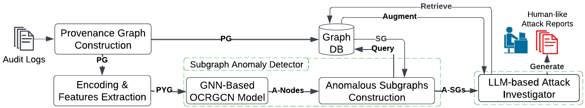
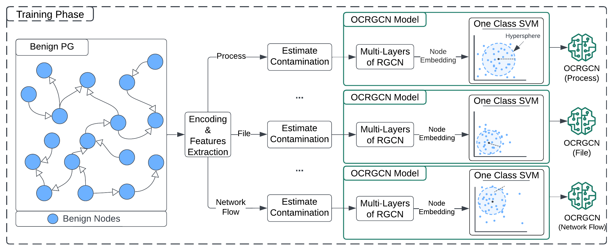
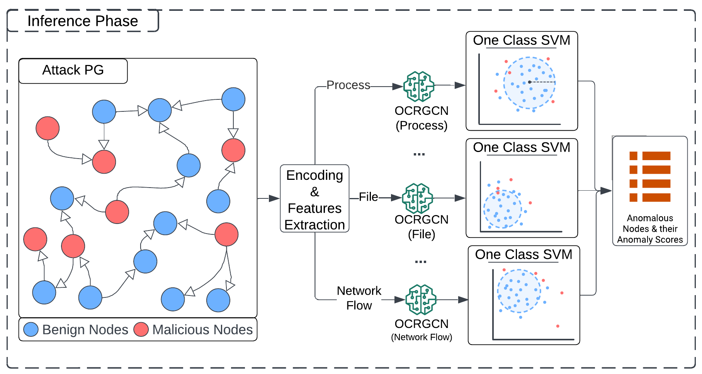

  
  

    ĐẠI HỌC QUỐC GIA TP.HCM TRƯỜNG ĐẠI HỌC CÔNG NGHỆ THÔNG TIN
  

<h1 v-motion :initial="{ x: -60, opacity: 0 }" :enter="{ x: 0, opacity: 1, transition: { duration: 700 } }" style="font-size:2.05rem;line-height:1.2;color:#1e3a8a" class="mb-8">Phát hiện bất thường trên endpoint device log dựa trên OCR-APT</h1>

**Môn học:** An toàn bảo mật hệ thống thông tin 
**GV:** Nguyễn Tấn Cầm 
Học kì 2026–2027

**Thành viên** 
Ngô Vũ Minh Đạt – 26848033@grad.uit.edu.vn 
Nguyễn Long Vũ – 250202060@grad.uit.edu.vn 
Trần Quang Kiệt – 26848108@grad.uit.edu.vn

<!--
Chào thầy/cô và các bạn. Nhóm trình bày một demo trực tiếp của OCR-APT (CCS 2025): phát hiện tấn công
trên log nhân (kernel log) của Windows bằng subgraph anomaly detection. Bốn phần: bài toán → ý tưởng cốt
lõi (5 bước) → demo (video chính trên ws-etw-0 + tấn công thật của thành viên trên ws-etw-1) → cảm ơn. Chi tiết đầy đủ nằm trong báo cáo (latex/).
-->

---
clicks: 2
---

# 1 · Bài toán & OCR-APT

**Cách cũ**
- Rule → **bỏ sót** kỹ thuật mới

**OCR-APT** (CCS 2025)
- **Subgraph** · **behavior** · **LLM**
- Mục tiêu: tấn công **đỏ**, benign **xanh**, live · **mỗi host một mô hình**

  
  1
  2
  3
  4
  5

Hình 1 của Aly et al., CCS 2025; số thứ tự do nhóm thêm vào

1 provenance graph &nbsp;·&nbsp; 2 behavior feature &nbsp;·&nbsp; 3 OCRGCN theo loại node &nbsp;·&nbsp; 4 anomalous subgraph &nbsp;·&nbsp; 5 LLM báo cáo

<!--
Tấn công ẩn trong audit log khổng lồ, cực hiếm, không nhãn. Cách cũ: luật thì bỏ sót kỹ thuật mới;
anomaly detection thì hoặc quá vụn (từng node) hoặc quá thô (cả đồ thị); và chỉ cho cảnh báo rời, không
dựng được câu chuyện. OCR-APT trả lời bằng subgraph + học hành vi (không dùng tên/IP) + LLM.
Mục tiêu đồ án rất hẹp: demo phần lõi chạy sống trên Windows host (mỗi host một mô hình), không đua số liệu với bài báo.
Năm bước dưới hình là bản đồ cho phần 2. Chi tiết hạn chế cách cũ: note.txt Q8; báo cáo §1.
-->

---
clicks: 4
---

# 2 · ① Provenance graph

<AttackGraph />

- Node: `PROCESS` · `FILE` · `NET`
- Edge: `Start` `Load` `Read` `Write` `Send` `Recv` + thời gian

- Tên / path / IP → **không vào model**
- Giả định: log train **sạch**

<!--
Mỗi click thêm một bước tấn công theo thời gian. Process làm gì với file và mạng trở thành đồ thị; chủ
thể luôn là process. Loại edge quan trọng — "ghi" khác "đọc". Tên/IP được giữ lại cho bước điều tra
nhưng KHÔNG đưa vào mô hình, để mô hình không học bề mặt dễ giả mạo. Threat model: log huấn luyện sạch.
-->

---
clicks: 4
---

# 2 · ② Behavior feature: đếm hành động

Mỗi node: <b>làm gì, bao nhiêu lần</b> · 12 out/in + 3 idle = <b>15 số</b> · không tên/IP

<BehaviorCounts />

<!--
Trực giác quan trọng nhất của đồ án. Click 1: chrome duyệt web. Click 2: một macro mở powershell.
Click 3: rundll32 nạp DLL rồi beacon ra ngoài. Bảng đếm dần ĐÚNG các feature đem huấn luyện: mỗi event
cộng 1 vào out_<action> của source và 1 vào in_<action> của destination. 12 cột đếm (chuẩn hoá L2) + 3 cột
thời gian nghỉ (min-max) = 15 số mỗi node → ma trận [9, 15] cho vết 17 event này. rundll32 im 214 s trước
khi gửi ra ngoài → max nghỉ 0.99. Bảng đầy đủ: báo cáo Bảng feature cuối (§2.2). Ví dụ số L2: note.txt Q-L2.
-->

---
clicks: 5
---

# 2 · ③ RGCN: một trọng số cho mỗi loại edge

**R**elational **G**raph **C**onvolutional **N**etwork · GNN cho đồ thị có **nhiều loại edge**

<RgcnLayer />

**$W_r$ riêng** mỗi loại edge · `Load` ≠ `Write` · 15 feature → **embedding 32 chiều**

<!--
RGCN = Relational Graph Convolutional Network: một GNN. Ý tưởng GNN (message passing): mỗi lớp, mọi node gộp
thông tin từ chính nó và các neighbor rồi cập nhật vectơ; xếp L lớp thì nhìn xa L bước (OCR-APT 3 lớp, exp08 2 lớp).
"Relational" = đồ thị có nhiều loại edge. Mỗi loại edge (Write/Read/Send/Recv/Start/Load) có ma trận trọng số riêng W_r, nên
mô hình học mỗi loại "kéo" bao nhiêu. Animation: rundll32 gộp chính nó + 2 file + 1 flow, mỗi loại qua
trọng số riêng → 0.1. Sau 2–3 lớp, 15 feature thô thành embedding 32 chiều mang cả chuỗi tài liệu →
powershell → DLL → rundll32 → mạng. Vì sao RGCN chứ không GCN: note.txt Q1; 12 quan hệ: Q3; công thức: báo cáo §2.3.
-->

---
clicks: 3
---

# 2 · ③ Nhiều lớp: nhìn xa L bước

<StackedLayers />

<!--
Mỗi lớp, mọi node cập nhật vectơ từ chính nó và các neighbor (message passing — RGCN làm đúng việc này, chỉ thêm
trọng số riêng theo loại edge). Mỗi lớp nhìn xa thêm một bước: A chỉ nhận được màu của E ở lớp 3. Vectơ sau mỗi
lớp là hidden layer (mô hình tự tính, không có trong log); lớp cuối là embedding, đem vào quả cầu one-class.
Bài báo dùng 3 lớp; nhóm dùng 2 trên exp08 (nông hơn, bớt nhạy với nhiễu ngữ cảnh). Quá nhiều lớp thì mọi node
trộn thành một màu xám (over-smoothing): note.txt Q6. Ví dụ số: note.txt Q5.
-->

---
clicks: 2
---

# 2 · ③ OCRGCN: học "bình thường", gắn cờ cái ở xa

**O**ne-**C**lass **R**elational **G**raph **C**onvolutional **N**etwork

<Hypersphere />

Không nhãn → chỉ học <b>benign</b>

Trong cầu = <b>quen</b> · ngoài cầu = <b>gắn cờ</b>

$s_i = \lVert \mathbf z_i - \mathbf c \rVert^2 - R^2 > \theta$

<!--
Không có nhãn nên chỉ học "bình thường": nhốt benign embedding vào một quả cầu (tâm c, bán kính R), cái
gì ra ngoài thì nghi ngờ — tinh thần One-Class SVM. OCRGCN = One-Class RGCN: bài báo mô tả là "RGCN kết hợp one-class SVM" (§1, §5.1.1) nhưng không viết rõ tên đầy đủ, nên "One-Class RGCN" là cách đọc của nhóm từ mô tả đó. Bản của nhóm = encoder RGCN + loss kiểu Deep SVDD. sᵢ là
khoảng cách tới tâm trừ bán kính; vượt threshold θ thì gắn cờ. Điểm then chốt: một mô hình cho MỖI loại
node, vì "bình thường" của process/file/mạng khác nhau. Encoder vẫn nhìn toàn đồ thị; chỉ loss/threshold
theo loại. β, threshold, Hình 2 bài báo: báo cáo §2.4–2.5.
-->

---

# 2 · ③ OCRGCN: huấn luyện (Training)

Hình 2 (trái) của Aly et al., CCS 2025: pha Training

- Chỉ **benign** · **mỗi loại node một mô hình** (Process · File · Network Flow)
- **Estimate Contamination** γ → đặt threshold θ
- **RGCN** → embedding → **hypersphere** (One-Class SVM)

<!--
Pha huấn luyện (Hình 2 trái). Đồ thị chỉ gồm benign node → mã hoá + 15 feature → tách theo loại node.
Mỗi loại một OCRGCN: ước lượng contamination γ (tỉ lệ điểm huấn luyện được phép vượt threshold; θ = quantile
1 − γ của điểm huấn luyện; bài báo kẹp γ trong [0.001, 0.05], không nhãn thì 0.001 — nhóm dùng 0.001), qua nhiều
lớp RGCN ra embedding, rồi học hypersphere (tâm c, bán kính R). Kết quả: 3 mô hình. Encoder vẫn chạy trên toàn
đồ thị; chỉ loss/hypersphere/threshold tính riêng theo loại. Báo cáo §2.4–2.5 (Hình tsmod).
-->

---

# 2 · ③ OCRGCN: suy luận (Inference)

Hình 2 (phải) của Aly et al., CCS 2025: pha Inference

- Đồ thị mới (có thể có tấn công) → **cùng** feature + scaler
- Mỗi node → mô hình **đúng loại** → khoảng cách tới tâm
- Ngoài cầu = **anomalous node + score** → bước ④

<!--
Pha suy luận (Hình 2 phải). Đồ thị cần kiểm tra đi qua đúng các bước mã hoá + feature (dùng lại scaler của
lúc train); mỗi node được chấm bởi mô hình của loại mình, sᵢ > θ của loại đó thì là anomalous node. Đầu ra:
danh sách anomalous node kèm điểm → đưa vào bước ④ dựng subgraph. Khác bài báo: bài báo chấm cả log một lần
(offline); bản live của nhóm chấm từng window 5 phút (DEVIATIONS: windowed detection).
-->

---

# 2 · ④⑤ Subgraph → cảnh báo → LLM

### ④ Alg. 1 + SG-Det
- Nối node bị cờ → **subgraph**
- Điểm = **Σ xác suất** node bị cờ
- **≥ 10 → Moderate → đỏ** (thang bài báo)
- Live hai máy: **≥ 4.5**

### ⑤ LLM
- Subgraph → **IOC** → lọc hallucination → **báo cáo**
- **triage** trước: `attack` / `benign` / `uncertain`
- **Overlay**: không xoá cảnh báo, không vào training

<!--
Node rời rạc → subgraph có điểm → báo cáo. Điểm subgraph là TỔNG xác suất (min-max, kẹp [0,1]) của node
bị cờ, nên ≥10 ≈ ít nhất ~10 node bất thường nối thành một câu chuyện. Thang Minor <10, Moderate 10–100,
Significant 100–1000, Critical >1000 (§7.2.1); không dùng top-k fallback vì sẽ làm mọi window đỏ.
Video demo chính (exp08) dùng đúng mốc 10; live trên hai máy dùng mốc 4.5 (≈ 5 node bất thường liên thông).
LLM đọc subgraph, trích IOC, lọc phần bịa, viết báo cáo; nhóm thêm bước phân loại trước (bài báo luôn giả
định tấn công). LLM chỉ là lớp phủ (rủi ro prompt injection). Công thức: báo cáo Phụ lục.
-->

---

# 3 · Demo: hạ tầng lab (Proxmox)

<LabInfra />

Terraform + Ansible · <b>hai</b> Windows host, mỗi host một mô hình

<!--
Lab trên một hypervisor Proxmox. ws-etw-0 chạy DVWA (web có lỗ hổng) và etwcollect (collector ETW nhóm tự viết);
từ 09-11 nó còn là Domain Controller (video demo chính quay trước đó, mô hình exp08). ws-etw-1 là máy thứ hai:
ứng dụng Next.js có lỗ hổng RCE (react2shell) do một thành viên dựng, mô hình riêng exp15-ws1.
ubuntu-trainer chạy Loki, Grafana, huấn luyện và ocr-live (máy chủ demo, một engine cho mỗi host).
① Kali khai thác DVWA, ② log ETW của cả hai host đẩy về Loki, ③ ocr-live phục vụ giao diện cảnh báo,
④ thành viên tấn công thật ws-etw-1 từ máy mình qua VPN. Correlation giữa hai host: đã viết, chưa kiểm chứng.
-->

---

# 3 · Đường đi dữ liệu

<OurPipeline />

  JSON line<b>→</b>
  <i class="num">1</i>edge (src, action, dst, ts)<b>→</b>
  <i class="num">2</i>X [N, 15]<b>→</b>
  <i class="num">3</i>sᵢ mỗi node<b>→</b>
  <i class="num">4</i>subgraph Σp ≥ 10<b>→</b>
  <i class="num">5</i>xanh / đỏ + báo cáo

Benign = <b>idle 3 ngày</b> · <b>cùng code</b> train ↔ live

<!--
Theo một dòng log đi hết hệ thống. etwcollect trên ws-etw-0 đọc ETW (process/file/mạng), ghi thành dòng
JSON và tự đẩy về Loki trên ubuntu-trainer. Từ đó: ① dòng log thành edge (process nào làm gì với ai, lúc
nào), cắt theo window 5 phút; ② mỗi node thành 15 số, dùng scaler của tập train; ③ OCRGCN cho mỗi node một
điểm sᵢ; ④ Alg. 1 nối các node bị cờ thành subgraph, tổng xác suất ≥ 10 thì window đỏ; ⑤ LLM (tuỳ chọn)
phân loại và viết báo cáo; giao diện web hiện window xanh/đỏ. Cùng một code cho huấn luyện (benign idle
~3 ngày kéo từ Loki) và demo. Cách cắt window (sliding khi train, tumbling khi live): báo cáo §3.
-->

---
clicks: 8
---

# 3 · Kịch bản tấn công: RCE kill chain

<KillChain />

Kali → DVWA trên ws-etw-0 · nhãn tự ghi (self-log) làm oracle

<!--
Một chuỗi tấn công duy nhất, chạy lại được, từ Kali. Click qua từng giai đoạn: khai thác DVWA command
injection → RCE (httpd→cmd→powershell) → discovery → quét mạng → tải & chạy tool thật (PsExec, rclone)
→ dump MySQL → C2 beacon → scheduled task → xoá log (T1070). Lab cô lập, Defender tắt, VM dùng một lần.
Script: src/atomic-attack-pack/scenarios/rce-killchain.ps1.
-->

---
layout: center
class: text-center
---

# 3 · Video demo

  <iframe src="https://www.youtube-nocookie.com/embed/Jzv03v82bNo?rel=0"
    title="Video demo" frameborder="0" allowfullscreen
    allow="accelerometer; autoplay; clipboard-write; encrypted-media; gyroscope; picture-in-picture" />

① idle <b>xanh</b> → ② kill chain chạy → ③ window <b>đỏ</b> + subgraph → ④ kết luận LLM · <a href="https://www.youtube.com/watch?v=Jzv03v82bNo" target="_blank">youtu.be/Jzv03v82bNo</a>

<!--
Video demo đã quay sẵn (YouTube: https://www.youtube.com/watch?v=Jzv03v82bNo). Cần mạng để phát;
nếu mất mạng, mô tả bằng lời theo bốn bước dưới khung.
Kết quả đo được (exp08: window tấn công 05-11 17:10Z 70.17 / LLM attack 0.85; 24 h: 288 window, 7 alert, 3 false alarm)
và giới hạn nằm trong báo cáo §3–4; nếu được hỏi: note.txt Q7. Slide sau: video 2 (tấn công thật trên ws-etw-1).
-->

---
layout: center
class: text-center
---

# 3 · Video demo 2: tấn công thật trên ws-etw-1

  <!-- TODO (thành viên): thay khối placeholder này bằng iframe YouTube, giống slide "3 · Video demo":
  <iframe src="https://www.youtube-nocookie.com/embed/<VIDEO_ID>?rel=0" title="Video demo 2" frameborder="0" allowfullscreen
    allow="accelerometer; autoplay; clipboard-write; encrypted-media; gyroscope; picture-in-picture" /> -->
  

    

    
Video demo 2 · đang cập nhật

  

<!--
Placeholder: video do thành viên quay lần tấn công react2shell vào ws-etw-1 (15-11, 03:35–04:40Z), sẽ thay bằng
link YouTube. Kết quả (04:15Z 7.24 · 04:20Z 19.86 đỏ, LLM attack 0.85/0.95, mốc Moderate 4.5) nằm trong báo cáo §R4.
-->

---
layout: center
class: text-center
transition: fade
---

<h1 v-motion :initial="{ y: 30, opacity: 0 }" :enter="{ y: 0, opacity: 1, transition: { duration: 700, delay: 200 } }" style="font-size:2.6rem;color:#1e3a8a">Cảm ơn thầy/cô và các bạn đã lắng nghe!</h1>

Hỏi & Đáp

Kết quả, giới hạn, công thức, bảng sai khác: báo cáo <code>latex/</code> · <code>docs/DEVIATIONS.md</code>

<!--
Cảm ơn. Câu hỏi thường gặp đã chuẩn bị trong note.txt (RGCN vs GCN, 12 quan hệ, vì sao benign idle, kết
quả demo, công thức điểm subgraph, mốc Moderate 4.5...). Công thức RGCN, điểm subgraph và bảng sai khác đầy đủ nằm trong báo cáo.
-->
