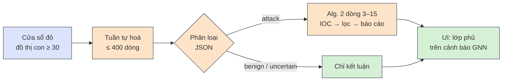

<div class="flex items-center gap-4 mb-6">
  
  <div class="text-sm leading-tight muted">
    ĐẠI HỌC QUỐC GIA TP.HCM<br/>TRƯỜNG ĐẠI HỌC CÔNG NGHỆ THÔNG TIN
  </div>
</div>

<h1 v-motion :initial="{ x: -60, opacity: 0 }" :enter="{ x: 0, opacity: 1, transition: { duration: 700 } }" style="font-size:2.05rem;line-height:1.2;color:#1e3a8a">Phát hiện bất thường trên endpoint device log dựa trên OCR-APT</h1>

<div v-motion :initial="{ x: -60, opacity: 0 }" :enter="{ x: 0, opacity: 1, transition: { duration: 700, delay: 250 } }" class="text-xl mt-1 mb-6">Subgraph Anomaly Detection với One-Class RGCN, chạy gần thời gian thực trên log ETW của Windows</div>

<div v-motion :initial="{ y: 30, opacity: 0 }" :enter="{ y: 0, opacity: 1, transition: { duration: 700, delay: 550 } }" class="grid grid-cols-2 gap-6 text-sm">
<div>

**Môn học:** [Tên môn học]<br/>
**Mã lớp:** [NT2102.xxx] · **GV:** [Họ tên giảng viên]<br/>
[Học kì – Năm học]

</div>
<div>

**[Nhóm xx]**<br/>
[MSSV] – [Họ và tên]<br/>
[MSSV] – [Họ và tên]<br/>
[MSSV] – [Họ và tên]

</div>
</div>

---

# Nội dung

<div class="grid grid-cols-2 gap-8 mt-4">
<div v-motion :initial="{ x: -40, opacity: 0 }" :enter="{ x: 0, opacity: 1, transition: { duration: 600 } }">

1. **Bài toán & mục tiêu**
2. **OCR-APT: cơ sở lý thuyết**
   - Đồ thị nguồn gốc, đặc trưng hành vi
   - RGCN, học một lớp, mô hình theo loại nút
   - Đồ thị con bất thường (Alg. 1), điều tra bằng LLM

</div>
<div v-motion :initial="{ x: 40, opacity: 0 }" :enter="{ x: 0, opacity: 1, transition: { duration: 600, delay: 200 } }">

3. **Phương pháp triển khai**
   - Hạ tầng lab & pipeline, cửa sổ thời gian
   - Các điểm khác bài báo và lý do
4. **Giới hạn & kết luận**
5. **Demo trực tiếp** · <span class="demo-badge">DEMO</span>

</div>
</div>

<div class="tiny muted mt-10">

Nhãn nguồn dùng xuyên suốt: <span class="tag paper">PAPER</span> bài báo · <span class="tag repo">REPO</span> mã nguồn gốc · <span class="tag ours">OURS</span> nhóm làm khác · <span class="tag inf">INFERENCE</span> suy luận chưa kiểm chứng

</div>

---

# Bài toán: phát hiện tấn công từ log nhân của Windows

<div class="cmp small">
<div>

### Kịch bản mục tiêu
Khai thác lỗ hổng (CVE) của một dịch vụ web trong lab (T1190) → **thực thi mã từ xa** → các kỹ thuật ATT&CK: khám phá, duy trì truy cập, đánh cắp thông tin xác thực, C2, rút dữ liệu.

### Vì sao khó
- Log nhân ghi **mọi** tiến trình, tệp, kết nối → khối lượng rất lớn
- Phần tấn công < **0.01%** số nút trong các bộ dữ liệu chuẩn <span class="tag paper">PAPER</span>
- **Không có nhãn tấn công** để huấn luyện

</div>
<div v-click>

### Giới hạn của các hệ thống hiện có <span class="tag paper">PAPER §1–2</span>

| Vấn đề | Hệ quả |
|---|---|
| Luật / chữ ký | Không thấy kỹ thuật mới |
| Cảnh báo cả đồ thị / cả cửa sổ | Quá thô, khó điều tra |
| Cảnh báo từng nút | Quá vụn, nhiều dương tính giả |
| Dựa vào tên tệp, IP | Học chi tiết bề mặt, dễ giả mạo |
| Bỏ qua loại cạnh | "Đọc" và "ghi" như nhau |

</div>
</div>

<div v-click class="card ours small mt-3">

**Mục tiêu đồ án:** demo trực tiếp ý tưởng cốt lõi của OCR-APT. Khi tấn công thật chạy, cửa sổ chứa tấn công **chuyển đỏ**, còn cửa sổ lành tính **giữ xanh**. Proof of concept khoảng 40% hệ thống, không tái hiện bảng số liệu của bài báo.

</div>

---

# OCR-APT: log thô vào, báo cáo tấn công ra, qua 5 bước

<div class="relative mt-2">
  
  <span class="num absolute" style="left:8.5%;top:16%">1</span>
  <span class="num absolute" style="left:10.3%;top:63%">2</span>
  <span class="num absolute" style="left:31.2%;top:67%">3</span>
  <span class="num absolute" style="left:52.6%;top:60%">4</span>
  <span class="num absolute" style="left:79.6%;top:60%">5</span>
</div>
<div class="src">Hình 1 của Aly et al., CCS 2025; số thứ tự do nhóm thêm vào</div>

<div class="small mt-2">
<v-clicks>

- <span class="num">1</span> Dựng **đồ thị nguồn gốc** từ audit log
- <span class="num">2</span> Trích **đặc trưng hành vi** cho từng nút (không dùng tên, đường dẫn, IP)
- <span class="num">3</span> **OCRGCN** (one-class RGCN), một mô hình cho mỗi loại nút, chỉ học dữ liệu lành tính
- <span class="num">4</span> Gom nút bất thường thành **đồ thị con**, lọc theo điểm đồ thị con (SG-Det)
- <span class="num">5</span> **LLM** nhiều bước, có lọc ảo giác, viết báo cáo tấn công

</v-clicks>
</div>

---
clicks: 4
---

# ① Đồ thị nguồn gốc

<AttackGraph />

<div class="cmp small">
<div>

- Nút có đúng một loại: `PROCESS`, `FILE`, `NET` <span class="tag repo">REPO</span>
- Cạnh có loại + thời gian: `Start` `Load` `Read` `Write` `Send` `Recv`; chủ thể luôn là tiến trình

</div>
<div>

- Thuộc tính (tên, đường dẫn, IP:cổng) **không** vào mô hình, chỉ giữ cho bước điều tra <span class="tag paper">PAPER §5.1.1</span>
- Giả định: log huấn luyện **sạch** (threat model §3)

</div>
</div>

---

# ② Đặc trưng hành vi: nút *làm gì* và *nghỉ bao lâu*

<div class="cmp small">
<div>

### 12 tỉ lệ hành động, chuẩn hoá L2
Đếm 6 loại cạnh × 2 chiều (out / in) → $\mathbf{a} \in \mathbb{R}^{12}$, rồi chia cho độ dài:
$$\hat{\mathbf{a}} = \frac{\mathbf{a}}{\|\mathbf{a}\|_2},\qquad \|\mathbf{a}\|_2=\sqrt{a_1^2+\dots+a_{12}^2}$$

<v-clicks>

- Trình duyệt bận: send 300, recv 400 → $\|\mathbf a\|=500$ → **(0.6, 0.8)**
- Cùng trình duyệt lúc rảnh: 3, 4 → $\|\mathbf a\|=5$ → **(0.6, 0.8)**: cùng hành vi, cùng đặc trưng
- Tiến trình thả tệp: write 3, start 4 → cũng 0.6 / 0.8 nhưng ở **cột khác**

</v-clicks>
</div>
<div>

### 3 thống kê thời gian nghỉ, min-max
Khoảng cách (giây) giữa các sự kiện liên tiếp → min, max, trung bình, đưa về $[0,1]$:
$$x' = \frac{x - x_{\min}}{x_{\max} - x_{\min}}$$

<v-clicks>

- Sự kiện ở giây 0, 2, 3, 9 → nghỉ 2, 1, 6 → max 6 → $6/290 \approx 0.021$
- Nghỉ 300 s ở dữ liệu test → $300/290 \approx 1.03$, **vượt** $[0,1]$ vì thang đo cố định theo train

</v-clicks>
</div>
</div>

<div v-click class="card neutral small mt-3 text-center">

Mỗi nút: $\mathbf{x}_i \in \mathbb{R}^{15}$ → ma trận đặc trưng $X$ có kích thước **[N, 15]**. Bỏ các đặc trưng này (*Without B-Feat*): không phát hiện được nút nào trên host WS12 <span class="tag paper">PAPER Bảng 4</span>

</div>

---

# ③ RGCN: một ma trận trọng số cho mỗi loại cạnh

$$\mathbf{h}_i^{(l+1)} = \sigma\Big( W_0^{(l)} \mathbf{h}_i^{(l)} + \sum_{r \in \mathcal{R}} \sum_{j \in \mathcal{N}_i^r} \frac{1}{c_{i,r}} W_r^{(l)} \mathbf{h}_j^{(l)} \Big)$$

<div class="cmp small">
<div>

- $\mathbf{h}_i^{(l)}$: biểu diễn nút $i$ ở lớp $l$; $\mathbf{h}^{(0)} = \mathbf{x}$ (15 chiều)
- $\mathcal{N}_i^r$: láng giềng qua quan hệ $r$; $c_{i,r}=|\mathcal{N}_i^r|$ → lấy **trung bình**
- $W_0$: chính nút; $W_r$: riêng cho quan hệ $r$; $\sigma$ = ReLU
- Kích thước: **[N,15] → [N,32] → [N,32] → Z [N,32]**, 3 lớp <span class="tag paper">§7.2.1</span>
- 6 quan hệ + 6 quan hệ ngược `inv_r` → $|\mathcal R| = 12$ <span class="tag repo">REPO</span>

</div>
<div v-click class="card det">

### Ví dụ (đặc trưng 1 chiều)
Tiến trình $h_P=1$, hai tệp $h=2, 4$, một nút mạng $h=10$; $W_0=0.5$, $W_{write}=0.1$, $W_{send}=0.02$

- **Write**: $0.5 + \frac{2+4}{2}\cdot 0.1 + 10\cdot 0.02 = 0.5+0.3+0.2 =$ **1.0**
- Cùng hai tệp nhưng **Load**, $W_{load}=-0.2$: $0.5 - 0.6 + 0.2 =$ **0.1**

Cùng láng giềng, cùng đặc trưng, **khác loại cạnh → khác biểu diễn**. Đây là lý do chọn RGCN thay vì GCN.

</div>
</div>

---
clicks: 2
---

# ③ Học một lớp: "bình thường" là một siêu cầu

<div class="grid gap-4" style="grid-template-columns: 1.15fr 1fr">
<div>
<Hypersphere />
</div>
<div class="small">

Không có nhãn tấn công → chỉ học **lành tính trông thế nào**: tâm $\mathbf c$, bán kính $R$ (Deep SVDD / OCGNN, xây trên PyGOD) <span class="tag paper">PAPER</span>

$$s_i = \|\mathbf{z}_i - \mathbf{c}\|_2^2 - R^2$$

- $\mathbf z_i \in \mathbb R^{32}$: một hàng của $Z$; $s_i>0$ = ngoài cầu
- $\beta = 0.5$: tỉ lệ nút huấn luyện được phép nằm ngoài cầu
- Ngưỡng $\theta$ = phân vị $1-\gamma$ của điểm huấn luyện; không có nhãn → $\gamma = \mathit{Min}_{con} = 0.001$
- 1 000 nút, $\gamma=0.001$ → chỉ ~1 nút huấn luyện vượt $\theta$

</div>
</div>

---

# ③ Một mô hình riêng cho mỗi loại nút


<div class="src">Hình 2 của Aly et al., CCS 2025</div>

<div class="cmp small mt-2">
<div>

- Hành vi bình thường của **tiến trình, tệp, luồng mạng** khác nhau → ba siêu cầu, ba ngưỡng $\theta_\tau$
- Bộ mã hoá vẫn chạy trên **toàn đồ thị** (nhận thông điệp từ mọi loại láng giềng); loss và ngưỡng chỉ tính trên nút của loại đó

</div>
<div v-click class="card paper">

Bỏ mô hình theo loại nút (*Without TS-Mod*, một mô hình chung): recall trên host Ubuntu giảm **100% → 44%** <span class="tag paper">PAPER Bảng 4</span>

</div>
</div>

---

# ④ Từ nút rời rạc thành đồ thị con có điểm (Alg. 1 + SG-Det)


<div class="src">Hình 3 của Aly et al., CCS 2025: nút bị gắn cờ → nối trực tiếp → lân cận 1 bước → đồ thị con</div>

<div class="cmp small mt-2">
<div>

- Seed = top $n_{seed}=15$ nút bất thường mỗi loại; duyệt 1 bước, chỉ giữ đường tới nút bất thường khác
- Quá $max_e = 5\,000$ cạnh → chia bằng **Louvain**; loại đồ thị con trùng
- **SG-Det** loại mức *Minor*: giữ recall, tăng precision <span class="tag paper">Bảng 4</span>

</div>
<div v-click>

| Điểm đồ thị con | Mức | Cảnh báo? |
|---|---|---|
| < 10 | Minor | Không |
| 10 – 100 | Moderate | Có |
| 100 – 1 000 | Significant | Có |
| > 1 000 | Critical | Có |

<div class="tiny muted">Thang của bài báo §7.2.1. Đồ án dùng Moderate từ 30 (slide 15).</div>

</div>
</div>

---

# ⑤ Điều tra bằng LLM: nhiều bước nhỏ, mỗi bước được kiểm tra


<div class="src">Hình 4 của Aly et al., CCS 2025</div>

<div class="cmp small mt-2">
<div>
<v-clicks>

1. **Tuần tự hoá** đồ thị con thành "tài liệu log" (chủ thể – hành động – đối tượng)
2. **Trích IOC** bằng prompt Chain-of-Thought
3. **Lọc ảo giác**: bỏ IOC không có trong tài liệu gốc
4. **Báo cáo** từng đồ thị con
5. **Báo cáo tổng hợp** theo giai đoạn tấn công
6. LLM "giám khảo" chọn IOC chính, **làm giàu** báo cáo

</v-clicks>
</div>
<div v-click class="card inv">

- GPT-4o-mini, temperature 0; LLaMA3-8B cục bộ gần tương đương <span class="tag paper">§7.2.2</span>
- Bộ điều tra **luôn giả định** đồ thị con là tấn công; **không phân loại** tấn công / lành tính
- Đồ án dừng ở **bước 5** và thêm một bước phân loại trước (slide 16)

</div>
</div>

---

# Hạ tầng lab & pipeline của nhóm

<OurPipeline />

<div class="grid grid-cols-2 gap-4 small mt-1">
  <div class="card neutral !py-2"><b><code>ws-etw</code></b> · Windows Server 2022: SilkETW (Kernel-Process, -File, -Network) + <b>Grafana Alloy</b> gửi nguyên văn từng dòng; workload lành tính có seed; dịch vụ web chưa vá. <b>Không huấn luyện.</b></div>
  <div class="card neutral !py-2"><b><code>ubuntu-trainer</code></b> · Ubuntu 24.04: <b>Loki + Grafana</b>; chuyển đổi, cắt cửa sổ, đặc trưng, huấn luyện; máy chủ demo (FastAPI + web UI). Cả hai máy dựng bằng <b>Ansible</b>, chuyển lên cloud được.</div>
</div>

---
clicks: 1
---

# Cắt cửa sổ thời gian: 5 phút log được chấm điểm cùng nhau

<div class="grid gap-4" style="grid-template-columns: 1.45fr 1fr">
<div>
<Windows />
</div>
<div class="small">

Ký hiệu $[t, t+5)$: gồm $t$, **không** gồm $t+5$ <span class="tag ours">OURS</span>

- Huấn luyện: bản ghi ~20 phút, cửa sổ **trượt**; cửa sổ chồng lấn → hàng đặc trưng tương quan
- Demo: cửa sổ **lật**, mỗi sự kiện thuộc đúng một cửa sổ
- Mỗi nút được sao theo cửa sổ (`w0007_…`) → max idle ≤ 290 s
- Đồng hồ demo = thời gian sự kiện mới nhất − **20 s**; không có log mới → đồng hồ máy chủ
- Cửa sổ bắt đầu trước lúc thu thập: *partial*, không chấm

<div class="card atk tiny mt-2">

**Giới hạn:** tấn công kéo dài qua ranh giới cửa sổ chỉ được nhìn thấy từng mảnh.

</div>
</div>
</div>

---

# Các điểm đồ án làm khác bài báo

<div class="tiny">

| Thành phần | Bài báo / mã gốc | Đồ án <span class="tag ours">OURS</span> | Lý do |
|---|---|---|---|
| **Tấn công mục tiêu** | APT nhiều giai đoạn (DARPA, NODLINK) | CVE web → RCE → ATT&CK, chạy trong buổi demo | Demo thực tế, chạy lại được |
| **Dữ liệu** | DARPA TC3, OpTC, NODLINK mô phỏng | ETW tự thu thập, đưa về lược đồ NODLINK W10 | Làm chủ pipeline đầu–cuối |
| **Chế độ phát hiện** | Ngoại tuyến, toàn bộ log | Gần thời gian thực, cửa sổ 5 phút | Chấm điểm có giới hạn, tăng dần |
| **Đặc trưng** | Bỏ cột toàn 0; scaler fit train+test | Giữ đủ 15 cột; scaler chỉ fit trên train | Số chiều cố định; không rò test |
| **Mô hình** | OCRGCN trong fork PyGOD của tác giả | OCRGCN tự viết bằng `RGCNConv`, cùng siêu tham số | Giải thích được từng dòng |
| **Validation** | 15% nút ngẫu nhiên | Giữ cửa sổ cuối, loại 2 cửa sổ chồng lấn; patience 5 | Tránh rò giữa cửa sổ trượt |
| **Mức cảnh báo** | Moderate từ > 10; top-$k$ khi không có gì | Moderate từ **30**; không top-$k$ | Cửa sổ nhỏ; top-$k$ làm mọi cửa sổ đỏ |
| **LLM** | Alg. 2 đầy đủ, RAG | **Phân loại trước**, rồi Alg. 2 dòng 3–15; không RAG | GNN không phân biệt "lạ" với "độc hại" |

</div>

<div class="tiny muted mt-2">Danh sách đầy đủ (tác động + khẳng định bị giới hạn): <code>docs/DEVIATIONS.md</code> D1–D9.</div>

---

# Điểm đồ thị con & mốc cảnh báo 30

<div class="cmp small">
<div>

Điểm thô $s_i$ khác thang giữa các loại nút (NET có thể âm), nên văn bản bài báo ("tổng điểm") không cộng thẳng được. Mã gốc cộng **xác suất min-max**; đồ án làm theo <span class="tag repo">REPO</span>:

$$p_i = \operatorname{clamp}\!\left(\frac{s_i - s^{train}_{\min,\tau}}{s^{train}_{\max,\tau} - s^{train}_{\min,\tau}},\,0,\,1\right),\qquad score(sg)=\sum_{i\ \text{bất thường}} p_i$$

<v-clicks>

- FILE có điểm train trong $[0.10, 0.23]$; tệp $s=0.32$ → $1.69$ → kẹp **$p=1$**
- Tệp $s=0.165$ → $(0.165-0.10)/0.13 =$ **$p = 0.5$**
- Vì $p\le 1$: điểm ≥ 30 ⇔ **ít nhất ~30 nút bất thường** trong một câu chuyện liên thông

</v-clicks>
</div>
<div v-click class="card atk">

### Vì sao 30 (không phải 10) <span class="tag ours">OURS</span>
- Một cửa sổ 5 phút (~100–850 nút) nhỏ hơn rất nhiều đồ thị cỡ DARPA <span class="tag inf">INFERENCE</span>
- Trong lần chạy thử, **một** cửa sổ lành tính có trình cập nhật chưa thấy lúc train nạp 18 DLL → điểm **18** > 10
- Mốc 30 **che** dương tính giả đó, **không sửa** nó; cách sửa thật là mở rộng dữ liệu lành tính
- Không chỉnh mốc theo cửa sổ tấn công (sẽ là khớp ngưỡng theo dữ liệu test)

</div>
</div>

---

# LLM: phân loại trước, báo cáo sau



<div class="cmp small mt-2">
<div>
<v-clicks>

- Kết luận `attack` / `benign` / `uncertain` + tactic ATT&CK + dòng bằng chứng; bằng chứng phải có **nguyên văn** trong tài liệu, nếu không hạ thành `uncertain`
- Prompt của Alg. 2 sao **nguyên văn** từ mã gốc; bỏ dòng 16–25 (giám khảo, làm giàu báo cáo)
- Nhà cung cấp thay được: Anthropic, OpenAI, Ollama, mock

</v-clicks>
</div>
<div v-click class="card atk">

**Lớp phủ, không phải bộ lọc:** kết luận của LLM không bao giờ xoá cảnh báo của GNN và **không bao giờ** đưa ngược vào huấn luyện. Nội dung log (đường dẫn, tên tiến trình) do kẻ tấn công kiểm soát được → có thể **prompt injection**, và threat model giả định log huấn luyện sạch.

</div>
</div>

---
layout: center
---

# Giới hạn & kết luận

<div class="cmp small">
<div class="card atk">

### Đồ án **không** khẳng định
- So sánh P/R/F1 với Bảng 2–4 của bài báo: dữ liệu, nhãn, quy ước và chế độ phát hiện đều khác
- Tái hiện chính xác OCRGCN, Alg. 1 hay Alg. 2 đầy đủ
- Phát hiện APT, tấn công nhiều host hay kéo dài nhiều ngày

### Hạn chế đã biết
- Dữ liệu lành tính hẹp (workload dạng script, một máy)
- Mốc 30 đặt từ **một** cửa sổ lành tính, chưa kiểm chứng trên tấn công
- Cửa sổ 5 phút cắt rời hành vi kéo dài

</div>
<div class="card ours" v-click>

### Đóng góp
- Pipeline tự xây, kiểm tra được **từng bước**: ETW → NODLINK W10 → đặc trưng → OCRGCN theo loại nút → Alg. 1 → một phần Alg. 2
- OCR-APT chạy **theo cửa sổ gần thời gian thực**, cùng mã cho huấn luyện và demo
- Bước **phân loại bằng LLM** trước khi viết báo cáo, thứ bài báo không có
- Ghi lại **trung thực** mọi sai khác và giới hạn

### Hướng tiếp theo
Mở rộng dữ liệu lành tính · hiệu chỉnh ngưỡng trên nhiều phiên · cửa sổ trượt cho tấn công vượt ranh giới · thêm kịch bản tấn công

</div>
</div>

---
layout: center
class: text-center
transition: fade
---

<span class="demo-badge" v-motion :initial="{ scale: 0.4, opacity: 0 }" :enter="{ scale: 1, opacity: 1, transition: { type: 'spring', stiffness: 260, damping: 14 } }">LIVE DEMO</span>

# Lành tính giữ xanh, tấn công chuyển đỏ

<div class="text-left inline-block small mt-2">

```powershell
# ws-etw (PowerShell quyền admin): bắt đầu một lần thu thập live; Alloy tự gửi về Loki
C:\scripts\start-live.ps1 -Minutes 30

# Song song: workload lành tính (khởi chạy ứng dụng qua explorer)
C:\scripts\06-benign-workload.ps1 -DurationMinutes 20
```

```bash
# ubuntu-trainer: mô hình đang dùng + máy chủ demo
lab current                        # mô hình, bộ chuẩn hoá, converter_check
# Giao diện:  http://<trainer>:8000/     Grafana (log thô):  http://<trainer>:3000/
```

</div>

<div class="small mt-3">

① vài cửa sổ lành tính **xanh** → ② kịch bản tấn công (CVE → RCE → ATT&CK) chạy trên `ws-etw` → ③ cửa sổ đó **đỏ**, mở đồ thị con → ④ kết luận + báo cáo của LLM

</div>

---
layout: center
class: text-center
transition: fade
---


<h1 v-motion :initial="{ y: 30, opacity: 0 }" :enter="{ y: 0, opacity: 1, transition: { duration: 700, delay: 200 } }" style="font-size:2.6rem;color:#1e3a8a">Cảm ơn thầy/cô và các bạn đã lắng nghe!</h1>

<div v-motion :initial="{ y: 30, opacity: 0 }" :enter="{ y: 0, opacity: 1, transition: { duration: 700, delay: 500 } }" class="text-xl mt-2">Hỏi & Đáp</div>

<div class="small muted mt-10">

Báo cáo đầy đủ, kết quả thực nghiệm và danh sách sai khác: <code>latex/</code> · <code>docs/DEVIATIONS.md</code>

</div>
