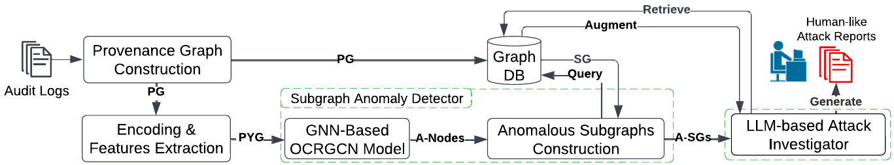
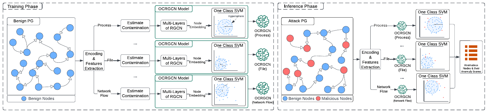
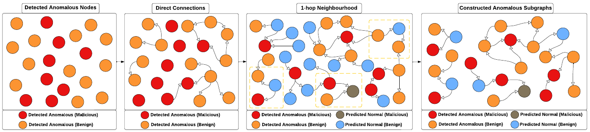
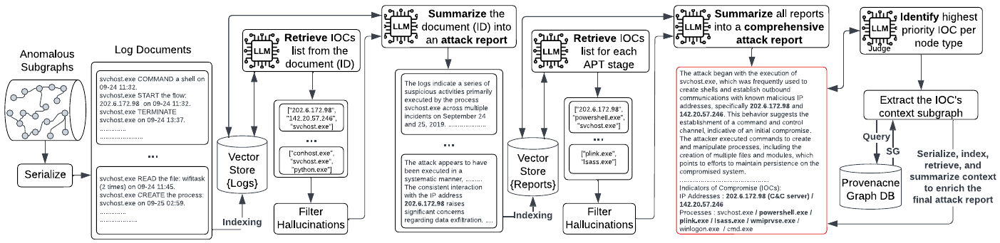
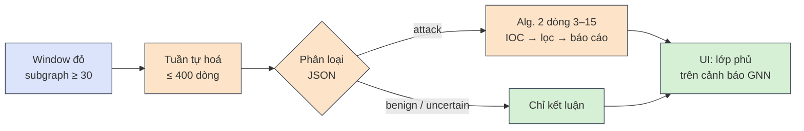

<div class="flex items-center gap-4 mb-6">
  
  <div class="text-sm leading-tight muted">
    ĐẠI HỌC QUỐC GIA TP.HCM<br/>TRƯỜNG ĐẠI HỌC CÔNG NGHỆ THÔNG TIN
  </div>
</div>

<h1 v-motion :initial="{ x: -60, opacity: 0 }" :enter="{ x: 0, opacity: 1, transition: { duration: 700 } }" style="font-size:2.05rem;line-height:1.2;color:#1e3a8a">Phát hiện bất thường trên endpoint device log dựa trên OCR-APT</h1>

<div v-motion :initial="{ x: -60, opacity: 0 }" :enter="{ x: 0, opacity: 1, transition: { duration: 700, delay: 250 } }" class="text-xl mt-1 mb-6">Subgraph Anomaly Detection với One-Class RGCN, chạy gần thời gian thực trên log ETW (Event Tracing for Windows)</div>

<div v-motion :initial="{ y: 30, opacity: 0 }" :enter="{ y: 0, opacity: 1, transition: { duration: 700, delay: 550 } }" class="grid grid-cols-2 gap-6 text-sm">
<div>

**Môn học:** An toàn bảo mật hệ thống thông tin<br/>
**GV:** Nguyễn Tấn Cầm<br/>
Học kì 2026–2027

</div>
<div>

**Thành viên**<br/>
Ngô Vũ Minh Đạt – 26848033@grad.uit.edu.vn<br/>
Nguyễn Long Vũ – 250202060@grad.uit.edu.vn<br/>
Trần Quang Kiệt – 26848108@grad.uit.edu.vn

</div>
</div>

---

# Nội dung

<div class="grid grid-cols-2 gap-8 mt-4">
<div v-motion :initial="{ x: -40, opacity: 0 }" :enter="{ x: 0, opacity: 1, transition: { duration: 600 } }">

1. **Bài toán & mục tiêu** · kiến thức nền GNN
2. **OCR-APT: cơ sở lý thuyết**
   - Provenance graph, behavior feature
   - RGCN, one-class learning, mô hình theo loại node
   - Anomalous subgraph (Alg. 1), điều tra bằng LLM

</div>
<div v-motion :initial="{ x: 40, opacity: 0 }" :enter="{ x: 0, opacity: 1, transition: { duration: 600, delay: 200 } }">

3. **Phương pháp triển khai**
   - Hạ tầng lab & pipeline, time window
   - Các điểm khác bài báo và lý do
4. **Giới hạn & kết luận**
5. **Demo trực tiếp** · <span class="demo-badge">DEMO</span>

</div>
</div>

<div class="tiny muted mt-10">

Nhãn nguồn dùng xuyên suốt: <span class="tag paper">PAPER</span> bài báo OCR-APT · <span class="tag ours">OURS</span> đồ án làm khác (mã của nhóm, <code>src/</code>) · <span class="tag inf">INFERENCE</span> suy luận chưa kiểm chứng<br>
<span class="tag repo">AUTHOR CODE</span> mã nguồn công khai của nhóm tác giả, <code>github.com/CoDS-GCS/OCR-APT</code> (gọi tắt "mã gốc")

</div>

---

# Bài toán: phát hiện tấn công từ kernel log của Windows

<div class="cmp small">
<div>

### Kịch bản mục tiêu
Khai thác vulnerability (CVE: Common Vulnerabilities and Exposures, mã lỗ hổng công khai) của một dịch vụ web trong lab → **remote code execution** (RCE: chạy lệnh từ xa) → các kỹ thuật MITRE ATT&CK (Adversarial Tactics, Techniques & Common Knowledge): khám phá, persistence, credential access, C2 (command and control), exfiltration.

### Vì sao khó
- Kernel log ghi **mọi** process, file, connection → khối lượng rất lớn
- Phần tấn công < **0.01%** số node trong các bộ dữ liệu chuẩn <span class="tag paper">PAPER</span>
- **Không có nhãn tấn công** để huấn luyện

</div>
<div v-click>

### Giới hạn của các hệ thống hiện có <span class="tag paper">PAPER §1–2</span>

| Vấn đề | Hệ quả |
|---|---|
| Luật / chữ ký | Không thấy kỹ thuật mới |
| Cảnh báo cả đồ thị / cả window | Quá thô, khó điều tra |
| Cảnh báo từng node | Quá vụn, nhiều false positive (cảnh báo nhầm) |
| Dựa vào tên file, IP | Học chi tiết bề mặt, dễ giả mạo |
| Bỏ qua loại edge | "Đọc" và "ghi" như nhau |

</div>
</div>

<div v-click class="card ours small mt-3">

**Mục tiêu đồ án:** demo trực tiếp ý tưởng cốt lõi của OCR-APT (Aly et al., ACM CCS 2025). Khi tấn công thật chạy, window (khung thời gian) chứa tấn công **chuyển đỏ**, còn benign (lành tính) window **giữ xanh**. Proof of concept phần lõi của bài báo, không tái hiện bảng số liệu của bài báo.

</div>

---
clicks: 4
---

# Kiến thức nền: Graph Neural Network (GNN) là gì?

<div class="grid gap-6 mt-1" style="grid-template-columns: 0.75fr 1.6fr">
<div class="small">

### Dữ liệu là đồ thị
- **Node** (thực thể) có một **vectơ** $h$: một dãy số mô tả node
- **Edge** nối các node
- Mô hình ML thường coi mỗi hàng **độc lập**: không biết hàng nào nối với hàng nào
- Đồ thị thì mỗi node có **số neighbor khác nhau**, không có thứ tự cố định

</div>
<div class="small">

### Ý tưởng cốt lõi: message passing (truyền thông điệp)
Mỗi lớp GNN, **mọi node** cập nhật vectơ của mình từ chính nó + các neighbor:

<MessagePassing />

</div>
</div>

---
clicks: 4
---

# Xếp nhiều lớp GNN: hidden layer là gì?

<StackedLayers />

<div v-click="4" class="cmp small mt-1">
<div class="card det">

**Hidden layer** = vectơ của node **sau mỗi lớp**: do mô hình tự tính, không có trong log. Xếp $L$ lớp = nhìn xa $L$ bước; OCR-APT dùng **3 lớp** <span class="tag paper">PAPER §7.2.1</span>.

</div>
<div class="card ours">

**Đầu ra:** hidden layer cuối = **embedding**, mô tả node + vùng xung quanh (A mang cả màu của E) → dùng để **phát hiện bất thường** (③).

</div>
</div>

---

# OCR-APT: log thô vào, báo cáo tấn công ra, qua 5 bước

<div class="relative mt-2">
  
  <span class="num absolute" style="left:8.5%;top:16%">1</span>
  <span class="num absolute" style="left:10.3%;top:63%">2</span>
  <span class="num absolute" style="left:31.2%;top:67%">3</span>
  <span class="num absolute" style="left:52.6%;top:60%">4</span>
  <span class="num absolute" style="left:79.6%;top:60%">5</span>
</div>
<div class="src">Hình 1 của Aly et al., CCS 2025; số thứ tự do nhóm thêm vào</div>

<div class="small mt-2">
<v-clicks>

- <span class="num">1</span> Dựng **provenance graph** (đồ thị nguồn gốc: process, file, kết nối là node, hành động là edge) từ audit log
- <span class="num">2</span> Trích **behavior feature** cho từng node (không dùng tên, đường dẫn, IP)
- <span class="num">3</span> **OCRGCN** (one-class RGCN: Relational Graph Convolutional Network), một mô hình cho mỗi loại node, chỉ học dữ liệu benign
- <span class="num">4</span> Gom anomalous node thành **subgraph**, lọc theo điểm subgraph (SG-Det: subgraph anomaly detection)
- <span class="num">5</span> **LLM** (Large Language Model) nhiều bước, có lọc hallucination (LLM bịa thông tin), viết báo cáo tấn công

</v-clicks>
</div>

---
clicks: 4
---

# ① Provenance graph

<AttackGraph />

<div class="cmp small">
<div>

- Node có đúng một loại: `PROCESS`, `FILE`, `NET` <span class="tag repo">AUTHOR CODE</span>
- Edge có loại + thời gian: `Start` `Load` `Read` `Write` `Send` `Recv`; chủ thể luôn là process

</div>
<div>

- Thuộc tính (tên, đường dẫn, IP:cổng) **không** vào mô hình, chỉ giữ cho bước điều tra <span class="tag paper">PAPER §5.1.1</span>
- Giả định: log huấn luyện **sạch** (threat model: mô hình mối đe doạ, §3)

</div>
</div>

---

# ② Behavior feature = đếm tần suất hành động

Từ raw log của một window: mỗi node **làm gì, bao nhiêu lần**? <span class="tag paper">PAPER §5.1.2</span>

<div class="cmp small">
<div>

### Raw log window (8 / 17 event)

```text
t (s)  source      action  destination
0.00   explorer  → Start → chrome
0.18   chrome    → Load  → kernel32.dll
2.41   chrome    → Send  → 198.51.100.23:443
2.53   chrome    → Recv  → 198.51.100.23:443
3.02   chrome    → Send  → 198.51.100.23:443
3.15   chrome    → Recv  → 198.51.100.23:443
3.29   chrome    → Recv  → 198.51.100.23:443
3.87   chrome    → Write → invoice.docm
…      9 event khác (powershell, rundll32)
```

</div>
<div v-click>

### Đếm → bảng tần suất

| process | in_start | start | load | send | recv | write | read |
|---|---|---|---|---|---|---|---|
| explorer | 0 | 2 | 0 | 0 | 0 | 0 | 0 |
| **chrome** | **1** | **0** | **1** | **2** | **3** | **1** | **0** |
| powershell | 1 | 1 | 0 | 1 | 1 | 1 | 1 |
| rundll32 | 1 | 0 | 2 | 1 | 0 | 0 | 0 |

<div class="tiny muted">start … read = các cột <code>out_*</code> (process là source)</div>

Mỗi event: **+1 `out_`** cho source, **+1 `in_`** cho destination → 6 action × 2 chiều = **12 cột**. File và NET node chỉ có cột `in_`.

</div>
</div>

<div v-click class="cmp small mt-3">
<div class="card neutral">

**+3 cột thời gian nghỉ** (cùng raw log, dùng timestamp)<br/>
chrome: event ở 0.00, 0.18, 2.41 … 3.87 s → nghỉ 0.18, 2.23, 0.12, 0.49, 0.13, 0.14, 0.58 → **min 0.12 · max 2.23 · mean 0.55** → min-max ($(x-\min)/(\max-\min)$) về $[0,1]$ theo train

</div>
<div class="card neutral">

**Chuẩn hoá L2 mỗi hàng** (chia cho độ dài Euclid): chrome $\|\mathbf a\| = \sqrt{1+1+4+9+1} = 4$ → recv $3/4 = 0.75$: giữ **tỉ lệ**, bỏ **độ bận**<br/>
12 cột đếm + 3 cột nghỉ = **15 số mỗi node**, $X$ = **[N, 15]**

</div>
</div>


<!--
Ví dụ trích từ docs/explainers/edges-to-node-features.html (17 event, 9 node).

Chuẩn hoá L2: chia hàng cho độ dài ‖a‖ = √(a1² + … + a12²).
- Chrome: ‖a‖ = √(1+1+4+9+1) = 4 → out_recv = 3/4 = 0.75.
- Trình duyệt bận: send 300, recv 400 → ‖a‖ = 500 → (0.6, 0.8). Lúc rảnh: 3, 4 → ‖a‖ = 5 → (0.6, 0.8): cùng hành vi, cùng feature.
- Process thả file: write 3, start 4 → cũng 0.6 / 0.8 nhưng ở cột khác.

Thời gian nghỉ (mã gốc làm tròn khoảng nghỉ về giây; ví dụ chrome trên slide để nguyên số lẻ cho dễ thấy): khoảng cách giữa các event liên tiếp → min, max, trung bình, min-max về [0,1] theo train.
- Event ở giây 0, 2, 3, 9 → nghỉ 2, 1, 6 → max 6 → 6/290 ≈ 0.021.
- Nghỉ 300 s ở test → 300/290 ≈ 1.03, vượt [0,1] vì thang đo cố định theo train.
-->

---

# ② Kết quả: mỗi node = 15 số

Toàn bộ 17 event ở slide trước → ma trận $X$ kích thước **[9, 15]**, đầu vào của RGCN <span class="tag paper">PAPER §5.1.2</span>

<div class="small">

<table class="feat">
<tr><th rowspan="2">node</th><th colspan="6" class="g">out_* (node là source)</th><th colspan="6" class="g">in_* (node là destination)</th><th colspan="3" class="g">thời gian nghỉ</th></tr>
<tr><th>write</th><th>read</th><th>send</th><th>recv</th><th>start</th><th>load</th><th>write</th><th>read</th><th>send</th><th>recv</th><th>start</th><th>load</th><th>min</th><th>max</th><th>mean</th></tr>
<tr><td class="n">explorer</td><td class="z">·</td><td class="z">·</td><td class="z">·</td><td class="z">·</td><td>1.00</td><td class="z">·</td><td class="z">·</td><td class="z">·</td><td class="z">·</td><td class="z">·</td><td class="z">·</td><td class="z">·</td><td>0.96</td><td>0.44</td><td>0.87</td></tr>
<tr class="hl"><td class="n">chrome</td><td>0.25</td><td class="z">·</td><td>0.50</td><td>0.75</td><td class="z">·</td><td>0.25</td><td class="z">·</td><td class="z">·</td><td class="z">·</td><td class="z">·</td><td>0.25</td><td class="z">·</td><td>0.00</td><td>0.01</td><td>0.00</td></tr>
<tr><td class="n">powershell</td><td>0.41</td><td>0.41</td><td>0.41</td><td>0.41</td><td>0.41</td><td class="z">·</td><td class="z">·</td><td class="z">·</td><td class="z">·</td><td class="z">·</td><td>0.41</td><td class="z">·</td><td>0.00</td><td>0.00</td><td>0.01</td></tr>
<tr class="hl"><td class="n">rundll32</td><td class="z">·</td><td class="z">·</td><td>0.41</td><td class="z">·</td><td class="z">·</td><td>0.82</td><td class="z">·</td><td class="z">·</td><td class="z">·</td><td class="z">·</td><td>0.41</td><td class="z">·</td><td>0.00</td><td class="hot">0.99</td><td>0.66</td></tr>
<tr><td class="n">kernel32.dll</td><td class="z">·</td><td class="z">·</td><td class="z">·</td><td class="z">·</td><td class="z">·</td><td class="z">·</td><td class="z">·</td><td class="z">·</td><td class="z">·</td><td class="z">·</td><td class="z">·</td><td>1.00</td><td>1.00</td><td>0.45</td><td>0.91</td></tr>
<tr><td class="n">invoice.docm</td><td class="z">·</td><td class="z">·</td><td class="z">·</td><td class="z">·</td><td class="z">·</td><td class="z">·</td><td>0.71</td><td>0.71</td><td class="z">·</td><td class="z">·</td><td class="z">·</td><td class="z">·</td><td>0.93</td><td>0.42</td><td>0.84</td></tr>
<tr><td class="n">stage.dll</td><td class="z">·</td><td class="z">·</td><td class="z">·</td><td class="z">·</td><td class="z">·</td><td class="z">·</td><td>0.71</td><td class="z">·</td><td class="z">·</td><td class="z">·</td><td class="z">·</td><td>0.71</td><td>0.01</td><td>0.00</td><td>0.01</td></tr>
<tr><td class="n">198.51.100.23:443</td><td class="z">·</td><td class="z">·</td><td class="z">·</td><td class="z">·</td><td class="z">·</td><td class="z">·</td><td class="z">·</td><td class="z">·</td><td>0.55</td><td>0.83</td><td class="z">·</td><td class="z">·</td><td>0.00</td><td>0.00</td><td>0.00</td></tr>
<tr><td class="n">203.0.113.50:8080</td><td class="z">·</td><td class="z">·</td><td class="z">·</td><td class="z">·</td><td class="z">·</td><td class="z">·</td><td class="z">·</td><td class="z">·</td><td>0.89</td><td>0.45</td><td class="z">·</td><td class="z">·</td><td>0.01</td><td class="hot">1.00</td><td>1.00</td></tr>
</table>

</div>

<div class="cmp small mt-3">
<div v-click class="card neutral">

**Hàng = hình dạng hành vi, không phải độ bận.** Process dùng cột `out_*`, file và NET chỉ dùng `in_*` → mỗi loại node một mô hình riêng (③).

</div>
<div v-click class="card atk">

**rundll32:** nạp DLL (Dynamic-Link Library) rồi im **214 s** mới gửi ra ngoài → max nghỉ **0.99**, flow 203.0.113.50 cũng **1.00**. Khoảng nghỉ dài bất thường là một tín hiệu.

</div>
</div>

<!--
Số liệu tính lại từ 17 event trong docs/explainers/edges-to-node-features.html.
- 12 cột đầu: số đếm chia ‖a‖ (L2), ví dụ chrome ‖a‖ = 4 → recv 0.75. "·" = 0.
- 3 cột nghỉ: khoảng nghỉ (giây, để nguyên số lẻ; mã gốc làm tròn về giây), rồi min-max. Ở đây scaler fit trên chính 9 node này cho minh hoạ; trong pipeline thật scaler fit trên dữ liệu train và dùng lại cho test/live.
- explorer, kernel32.dll, invoice.docm có giá trị nghỉ cao vì chỉ có 2 event cách nhau ~90 s: một khoảng nghỉ dài đơn lẻ, không phải tấn công. Feature cao không tự nó là bất thường; mô hình học xem tổ hợp nào là bình thường cho từng loại node.
-->

---
clicks: 5
---

# ③ Một lớp RGCN: node PROCESS rundll32 cập nhật giá trị

<RgcnLayer />

<div class="small mt-2 text-center">

1 lớp = nhìn xa thêm **1 bước** trên đồ thị · <span class="tiny muted">bài báo chỉ nói "aggregate"; mean/sum theo mã gốc <code>rgcn_conv.py</code></span> <span class="tag repo">AUTHOR CODE</span>

</div>

---

# ③ Công thức RGCN, từng phần

$$\mathbf{h}_i^{(l+1)} = {\color{#a51d1d}\sigma}\Big( {\color{#1e40af}W_0^{(l)} \mathbf{h}_i^{(l)}} + {\color{#166534}\sum_{r \in \mathcal{R}}} \; {\color{#9a3412}\sum_{j \in \mathcal{N}_i^r} \frac{1}{c_{i,r}}} \, {\color{#5b21b6}W_r^{(l)} \mathbf{h}_j^{(l)}} \Big)$$

<div class="small">

| Phần | Nghĩa | Trong ví dụ rundll32 (slide trước) | Kích thước (lớp 1) |
|---|---|---|---|
| <span style="color:#1e40af">$W_0 \mathbf h_i$</span> | node $i$ giữ lại thông tin của chính nó | $0.5 \cdot 1 = 0.5$ | $W_0$ [32 × 15], $\mathbf h_i$ [15] → [32] |
| <span style="color:#166534">$\sum_{r}$</span> | cộng lần lượt từng loại edge | Load, Send | 12 loại (6 + 6 ngược) |
| <span style="color:#9a3412">$\sum_{j \in \mathcal N_i^r} \frac{1}{c_{i,r}}$</span> | trung bình các neighbor nối bằng loại $r$; $c_{i,r}$ = số neighbor đó | 2 file → chia 2: $(2+4)/2 = 3$ | |
| <span style="color:#5b21b6">$W_r \mathbf h_j$</span> | biến đổi neighbor bằng trọng số **của loại $r$** | $3 \cdot (-0.2)$, $10 \cdot 0.02$ | $W_r$ [32 × 15] |
| <span style="color:#a51d1d">$\sigma$</span> | ReLU: số âm thành 0 | $\sigma(0.1) = 0.1$ | [32] |

</div>

<div class="small mt-2 text-center">

Trong một loại edge: **mean**. Giữa các loại edge và phần của chính nó: **sum**. Cuối cùng: ReLU (trừ lớp cuối) <span class="tag repo">AUTHOR CODE</span>

</div>

<div v-click class="card neutral small mt-2 text-center">

Các $W$ dùng **chung cho mọi node**: mô hình học "neighbor nối bằng Load nên nhân với trọng số nào", không học riêng cho rundll32. Vì vậy nó áp được lên node chưa từng thấy.

</div>

---
clicks: 4
---

# ③ Hidden layer: từ feature đến embedding

<HiddenLayers />

<!--
- Vì sao lấy trung bình (1/c_{i,r} = số neighbor loại r): một browser có 500 connection không được "to" hơn một browser có 5 connection chỉ vì nhiều neighbor; giống tinh thần chuẩn hoá L2 ở ②.
- W không có tham số riêng cho từng node: chỉ 1 W_0 và 12 W_r mỗi lớp, dùng chung cho mọi node.
- Mã: src/pipeline/train_gnn_models.py, dims = [in_dim] + [hid_dim] * num_layers (15 → 32 → 32 → 32).
-->

---
clicks: 2
---

# ③ One-class learning: "bình thường" là một hypersphere

<div class="grid gap-4" style="grid-template-columns: 1.15fr 1fr">
<div>
<Hypersphere />
</div>
<div class="small">

**Đầu vào:** $\mathbf z_i$ = hidden layer cuối của node $i$ (32 số, slide trước)

Không có nhãn tấn công → chỉ học **benign trông thế nào**: center $\mathbf c$, radius $R$ <span class="tag paper">PAPER</span>

$$s_i = \|\mathbf{z}_i - \mathbf{c}\|_2^2 - R^2$$

- $\mathbf z_i \in \mathbb R^{32}$: một hàng của $Z$; $s_i>0$ = ngoài cầu
- $\beta = 0.5$: tỉ lệ node huấn luyện được phép nằm ngoài cầu
- Threshold (ngưỡng) $\theta$ = quantile (phân vị) $1-\gamma$ của điểm huấn luyện; không có nhãn → $\gamma = 0.001$
- 1 000 node, $\gamma=0.001$ → chỉ ~1 node huấn luyện vượt $\theta$

</div>
</div>

---

# ③ Một mô hình riêng cho mỗi loại node


<div class="src">Hình 2 của Aly et al., CCS 2025</div>

<div class="small mt-2">

- Hành vi bình thường của **process, file, luồng mạng** khác nhau → ba hypersphere, ba threshold $\theta_\tau$
- Encoder vẫn chạy trên **toàn đồ thị** (nhận thông điệp từ mọi loại neighbor); loss và threshold chỉ tính trên node của loại đó

</div>

---

# ④ Từ node rời rạc thành subgraph có điểm (Alg. 1 + SG-Det)


<div class="src">Hình 3 của Aly et al., CCS 2025: node bị gắn cờ → nối trực tiếp → lân cận 1 bước → subgraph</div>

<div class="cmp small mt-2">
<div>

- Seed (node khởi đầu) = top $n_{seed}=15$ anomalous node mỗi loại; duyệt 1 bước, chỉ giữ đường tới anomalous node khác
- Quá $max_e = 5\,000$ edge → chia bằng **Louvain**; loại subgraph trùng
- **SG-Det**: bỏ subgraph mức *Minor* (< 10)

</div>
<div v-click>

| Điểm subgraph | Mức | Cảnh báo? |
|---|---|---|
| < 10 | Minor | Không |
| 10 – 100 | Moderate | Có |
| 100 – 1 000 | Significant | Có |
| > 1 000 | Critical | Có |

<div class="tiny muted">Thang của bài báo §7.2.1. Đồ án dùng Moderate từ 30 (slide 20).</div>

</div>
</div>

---

# ⑤ Điều tra bằng LLM: nhiều bước nhỏ, mỗi bước được kiểm tra


<div class="src">Hình 4 của Aly et al., CCS 2025</div>

<div class="cmp small mt-2">
<div>
<v-clicks>

1. **Tuần tự hoá** subgraph thành "tài liệu log" (chủ thể – hành động – đối tượng)
2. **Trích IOC** (Indicator of Compromise)
3. **Lọc hallucination**: bỏ IOC không có trong tài liệu gốc
4. **Báo cáo** từng subgraph
5. **Báo cáo tổng hợp** theo giai đoạn tấn công

</v-clicks>
</div>
<div v-click class="card inv">

- Bộ điều tra **luôn giả định** subgraph là tấn công; **không phân loại** tấn công / benign
- Đồ án dùng **bước 1–5** và thêm một bước phân loại trước (slide 21)

</div>
</div>

---

# Hạ tầng lab & pipeline của nhóm

<OurPipeline />

<div class="grid grid-cols-2 gap-4 small mt-1">
  <div class="card neutral !py-2"><b><code>ws-etw</code></b> · Windows Server 2022: <b>etwcollect</b> (collector Python tự viết: ghi ETW ra JSON; Kernel-Process, -File, -Network) tự gửi nguyên văn từng dòng về Loki; benign workload có seed; dịch vụ web chưa vá. <b>Không huấn luyện.</b></div>
  <div class="card neutral !py-2"><b><code>ubuntu-trainer</code></b> · Ubuntu 24.04: <b>Loki</b> (kho lưu log) + <b>Grafana</b> (dashboard); chuyển đổi, cắt window, feature, huấn luyện; máy chủ demo (FastAPI + web UI). Cả hai máy dựng bằng <b>Ansible</b>, chuyển lên cloud được.</div>
</div>

---
clicks: 1
---

# Cắt time window: 5 phút log được chấm điểm cùng nhau

<div class="grid gap-4" style="grid-template-columns: 1.45fr 1fr">
<div>
<Windows />
</div>
<div class="small">

Ký hiệu $[t, t+5)$: gồm $t$, **không** gồm $t+5$ <span class="tag ours">OURS</span>

- Huấn luyện: bản ghi ~20 phút, **sliding** window; overlapping window → hàng feature tương quan
- Demo: **tumbling** window (window lật), mỗi sự kiện thuộc đúng một window
- Mỗi node được sao theo window (`w0007_…`) → max idle ≤ 290 s
- Đồng hồ demo = thời gian sự kiện mới nhất − **20 s**; không có log mới → đồng hồ máy chủ
- Window bắt đầu trước lúc thu thập: *partial*, không chấm

<div class="card atk tiny mt-2">

**Giới hạn:** tấn công kéo dài qua ranh giới window chỉ được nhìn thấy từng mảnh.

</div>
</div>
</div>

---

# Các điểm đồ án làm khác bài báo

<div class="tiny">

| Thành phần | Bài báo / mã gốc | Đồ án <span class="tag ours">OURS</span> | Lý do |
|---|---|---|---|
| **Tấn công mục tiêu** | APT (Advanced Persistent Threat) nhiều giai đoạn | CVE web → RCE → ATT&CK, chạy trong buổi demo | Demo thực tế, chạy lại được |
| **Dữ liệu** | Bộ dữ liệu công khai của bài báo | ETW tự thu thập, đưa về lược đồ NODLINK W10 | Làm chủ pipeline đầu–cuối |
| **Chế độ phát hiện** | Ngoại tuyến, toàn bộ log | Gần thời gian thực, window 5 phút | Chấm điểm có giới hạn, tăng dần |
| **Feature** | Bỏ cột toàn 0; scaler fit train+test | Giữ đủ 15 cột; scaler chỉ fit trên train | Số chiều cố định; không rò test |
| **Mô hình** | OCRGCN trong mã của tác giả | OCRGCN tự viết bằng `RGCNConv`, cùng hyperparameter | Giải thích được từng dòng |
| **Validation** | 15% node ngẫu nhiên | Giữ window cuối, loại 2 overlapping window; patience 5 (dừng sau 5 epoch không cải thiện) | Tránh rò giữa sliding window |
| **Mức cảnh báo** | Moderate từ > 10; top-$k$ khi không có gì | Moderate từ **30**; không top-$k$ | Window nhỏ; top-$k$ làm mọi window đỏ |
| **LLM** | Alg. 2 đầy đủ | **Phân loại trước**, rồi Alg. 2 dòng 3–15 | GNN không phân biệt "lạ" với "malicious" |

</div>

<div class="tiny muted mt-2">Danh sách đầy đủ (tác động + khẳng định bị giới hạn): <code>docs/DEVIATIONS.md</code> D1–D9.</div>

---

# Điểm subgraph & mốc cảnh báo 30

<div class="cmp small">
<div>

Điểm thô $s_i$ khác thang giữa các loại node (NET có thể âm), nên văn bản bài báo ("tổng điểm") không cộng thẳng được. Mã gốc cộng **xác suất min-max**; đồ án làm theo <span class="tag repo">AUTHOR CODE</span>:

$$p_i = \operatorname{clamp}\!\left(\frac{s_i - s^{train}_{\min,\tau}}{s^{train}_{\max,\tau} - s^{train}_{\min,\tau}},\,0,\,1\right),\qquad score(sg)=\sum_{i\ \text{bất thường}} p_i$$

<v-clicks>

- FILE có điểm train trong $[0.10, 0.23]$; file $s=0.32$ → $1.69$ → kẹp **$p=1$**
- File $s=0.165$ → $(0.165-0.10)/0.13 =$ **$p = 0.5$**
- Vì $p\le 1$: điểm ≥ 30 ⇔ **ít nhất ~30 anomalous node** trong một câu chuyện liên thông

</v-clicks>
</div>
<div v-click class="card atk">

### Vì sao 30 (không phải 10) <span class="tag ours">OURS</span>
- Một window 5 phút (~100–850 node) nhỏ hơn rất nhiều đồ thị toàn bộ log trong bài báo <span class="tag inf">INFERENCE</span>
- Trong lần chạy thử, **một** benign window có trình cập nhật chưa thấy lúc train nạp 18 DLL → điểm **18** > 10
- Mốc 30 **che** false positive đó, **không sửa** nó; cách sửa thật là mở rộng dữ liệu benign
- Không chỉnh mốc theo window tấn công (sẽ là khớp threshold theo dữ liệu test)

</div>
</div>

---

# LLM: phân loại trước, báo cáo sau



<div class="cmp small mt-2">
<div>
<v-clicks>

- Kết luận `attack` / `benign` / `uncertain` + tactic ATT&CK + dòng bằng chứng; bằng chứng phải có **nguyên văn** trong tài liệu, nếu không hạ thành `uncertain`
- Prompt của Alg. 2 sao **nguyên văn** từ mã gốc; bỏ dòng 16–25 (giám khảo, làm giàu báo cáo)
- Nhà cung cấp thay được: Anthropic, OpenAI, Ollama, mock

</v-clicks>
</div>
<div v-click class="card atk">

**Lớp phủ, không phải bộ lọc:** kết luận của LLM không bao giờ xoá cảnh báo của GNN và **không bao giờ** đưa ngược vào huấn luyện. Nội dung log (đường dẫn, tên process) do kẻ tấn công kiểm soát được → có thể **prompt injection** (chèn lệnh vào prompt), và threat model giả định log huấn luyện sạch.

</div>
</div>

---
layout: center
---

# Giới hạn & kết luận

<div class="cmp small">
<div class="card atk">

### Đồ án **không** khẳng định
- So sánh số liệu với Bảng 2–4 của bài báo: dữ liệu, nhãn, quy ước và chế độ phát hiện đều khác
- Tái hiện chính xác OCRGCN, Alg. 1 hay Alg. 2 đầy đủ
- Phát hiện APT, tấn công nhiều host hay kéo dài nhiều ngày

### Hạn chế đã biết
- Dữ liệu benign hẹp (workload dạng script, một máy)
- Mốc 30 đặt từ **một** benign window, chưa kiểm chứng trên tấn công
- Window 5 phút cắt rời hành vi kéo dài

</div>
<div class="card ours" v-click>

### Đóng góp
- Pipeline tự xây, kiểm tra được **từng bước**: ETW → NODLINK W10 → feature → OCRGCN theo loại node → Alg. 1 → một phần Alg. 2
- OCR-APT chạy **theo window gần thời gian thực**, cùng mã cho huấn luyện và demo
- Bước **phân loại bằng LLM** trước khi viết báo cáo, thứ bài báo không có
- Ghi lại **trung thực** mọi sai khác và giới hạn

### Hướng tiếp theo
Mở rộng dữ liệu benign · hiệu chỉnh threshold trên nhiều session · sliding window cho tấn công vượt ranh giới · thêm kịch bản tấn công

</div>
</div>

---
layout: center
class: text-center
transition: fade
---

<span class="demo-badge" v-motion :initial="{ scale: 0.4, opacity: 0 }" :enter="{ scale: 1, opacity: 1, transition: { type: 'spring', stiffness: 260, damping: 14 } }">LIVE DEMO</span>

# Benign giữ xanh, tấn công chuyển đỏ

<div class="text-left inline-block small mt-2">

```powershell
# ws-etw (PowerShell quyền admin): bắt đầu một lần thu thập live; etwcollect tự gửi về Loki
C:\scripts\start-live.ps1 -Minutes 30

# Song song: benign workload (khởi chạy ứng dụng qua explorer)
C:\scripts\06-benign-workload.ps1 -DurationMinutes 20
```

```bash
# ubuntu-trainer: mô hình đang dùng + máy chủ demo
lab current                        # mô hình, scaler, converter_check
# Giao diện:  http://<trainer>:8000/     Grafana (log thô):  http://<trainer>:3000/
```

</div>

<div class="small mt-3">

① vài benign window **xanh** → ② kịch bản tấn công (CVE → RCE → ATT&CK) chạy trên `ws-etw` → ③ window đó **đỏ**, mở subgraph → ④ kết luận + báo cáo của LLM

</div>

---
layout: center
class: text-center
transition: fade
---


<h1 v-motion :initial="{ y: 30, opacity: 0 }" :enter="{ y: 0, opacity: 1, transition: { duration: 700, delay: 200 } }" style="font-size:2.6rem;color:#1e3a8a">Cảm ơn thầy/cô và các bạn đã lắng nghe!</h1>

<div v-motion :initial="{ y: 30, opacity: 0 }" :enter="{ y: 0, opacity: 1, transition: { duration: 700, delay: 500 } }" class="text-xl mt-2">Hỏi & Đáp</div>

<div class="small muted mt-10">

Báo cáo đầy đủ, kết quả thực nghiệm và danh sách sai khác: <code>latex/</code> · <code>docs/DEVIATIONS.md</code>

</div>
